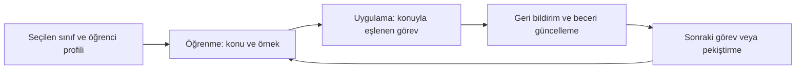

# 01 — Ventra Product Vision

**Durum:** v0.1, kısmen kabul / kısmen açık

## 1. Ürün tanımı — KABUL
**Ventra**, çocukların bir **Öğrenme Merkezi** ile konuları kavradığı ve bir **Macera Evreni** içinde bu bilgileri gerçek oyun mekanikleriyle uyguladığı, ortak beceri/ilerleme sistemine sahip eğitim platformudur.

- İlk oynayışta hesap zorunluluğu yoktur; birden fazla yerel çocuk profili mümkündür.
- Yetişkin isterse e-posta OTP ile hesabı bağlayıp bulut yedeklemeyi kullanabilir.
- Temel mimari Web + Android + iOS hedeflidir; iOS için gerçek cihazda yayımlanabilirlik henüz doğrulanmamıştır.
- İleride okul/öğretmen (B2B) ve aile (B2C) deneyimleri mümkün; öğretmen paneli mevcut üretim kapsamı değildir.

## 2. Asıl ürün deneyimi

**Tasarım ilkesi:** Matematik, oyunun üstüne yapıştırılan çoktan seçmeli soru olarak değil; nesneler, kaynaklar, kurallar ve oyuncu kararları yoluyla mekaniğin içine yerleşmelidir.

## 3. Ölçekleme ilkesi — KABUL
**40 matematik konusu = 40 bağımsız mini oyun değil.**

- Müfredata uygun eğitim modülleri *konu/kazanım* bazında hazırlanır.
- Oyun motoru/temel mekanikler az sayıda ve yeniden kullanılabilir olur.
- Bir mekanik farklı sınıf ve derslerde **ayrı görev tasarımlarıyla** çalışabilir.
- İçerik, yaşa ve sınıfa göre yeni görev kuralları, soyutlama düzeyi, okuma yükü ve yardım seviyeleriyle değişir.
- Her kazanımı oyunlaştırmak şart değildir; bazılarında etkileşimli öğrenme veya uygulama daha etkilidir.

## 4. Vizyon ≠ onaylanmış sürüm kapsamı
| Alan | Durum | Açıklama |
|---|---|---|
| Pilot konu | KABUL | 4. sınıf matematik / kesirler mevcut prototip temelidir |
| Ürün modeli | KABUL | Öğrenme Merkezi + Macera Evreni + ortak ilerleme |
| Oyunun başlıca deneyimi | ÖNERİ | Keşif ortamına bağlı farklı mekanikli kısa oyunlar |
| İlk ticari sürümün sınıf aralığı | AÇIK | Sadece 4. sınıf mı, 2–4 mü, farklı bir alt küme mi? |
| İlk sürümün dersleri | AÇIK | Matematik odaklı çıkış mı, çoklu ders mi? |
| Karakter/evren görsel standardı | AÇIK | 2D / 2.5D / seçici 3D; referans ekranlar onaylanmadı |
| İlk yayımlanacak oyun sayısı/türleri | AÇIK | Oyun listesi henüz seçilmedi |
| B2B öğretmen/okul yönetimi | ERTELENDİ | Uzun vadeli ürün kolu |

## 5. Kalite vaadi — önerilen ilkeler
- Çocuk oynarken **neyi öğrendiğini** ölçebiliriz; yalnızca yıldız toplamayı başarı saymayız.
- Her yeni oyun mekanik olarak diğerlerinden ayırt edilir.
- Görev başarısızlığı açıklayıcı geri bildirim üretir, cezalandırmaz.
- Yaş ve erişilebilirlik ihtiyaçlarına uygun kısa, anlaşılır kontrol ve arayüz.
- Reklam, satın alma, kişisel veri ve çocuk güvenliği kararları ayrıca hukuki/politika denetiminden geçer.

**Not:** Yukarıdaki kalite ilkeleri öneridir; ürün kriterlerine dönüştürülmeden “uygulandı” diye raporlanamaz.
