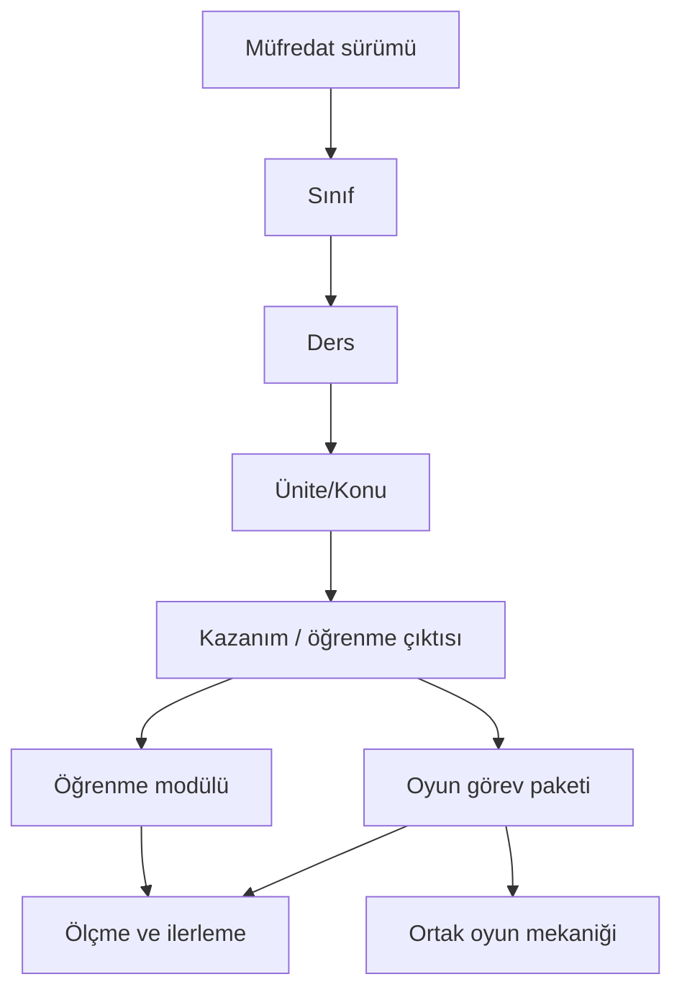

# 03 — Curriculum Matrix / Müfredat eşleme yöntemi

**Durum:** Şema önerisi; içerik kataloğu henüz doldurulmadı ve resmî kaynaklarla doğrulanmadı.

## Temel kural
**Sınıf başına bağımsız oyun üretmeyiz.** Bir oyun ailesi, sınıf seviyesine uyarlanmış **görev paketlerini** oynatır; öğrenme içerikleri ise ilgili konu/kazanıma göre hazırlanır.

## Önerilen kayıt alanları
| Alan | Anlamı |
|---|---|
| `curriculum_version` | Resmî programın adı/yılı/sürümü |
| `grade` | 1, 2, 3, 4... |
| `subject` | Matematik, Türkçe, Fen vb. |
| `unit`, `topic` | Ünite ve konu adı |
| `outcome_id`, `outcome_text` | Resmî kaynaktaki kazanım/öğrenme çıktısı; aynen doğrulanır |
| `source_url`, `verified_at` | MEB resmî belge bağlantısı ve kontrol tarihi |
| `skill_ids` | Uygulamanın ölçtüğü akademik beceriler |
| `learning_module_id` | Ders anlatımı/etkileşim bağlantısı |
| `mission_pack_ids` | Bir veya daha fazla oyun görevi paketi |
| `coverage_status` | `taslak`, `kaynak_doğrulandı`, `hazır`, `test_edildi` |
| `review_owner`, `last_reviewed` | İçerik kontrolünden sorumlu kişi ve tarih |

## Örnek karşılaştırma (temsili; MEB eşlemesi DEĞİL)
| Sınıf | Aynı oyun | Farklı görev içeriği | Neden farklı? |
|---|---|---|---|
| 2 | Market simülasyonu | Az ürün, bütün TL ile kolay alışveriş | Temel işlemler + düşük okuma yükü |
| 4 | Market simülasyonu | Bütçe, farklı teklifler, çok adımlı maliyet | Strateji ve çok adımlı muhakeme |

> Örnekler pedagojik tasarım örneğidir. Resmî kazanım kodu iddia etmez.

## İlk pilot eşleme taslağı
| Sınıf / ders | Konu | Öğrenme modülü | Oyun | Durum |
|---|---|---|---|---|
| 4 / Matematik | Kesirler, parçalar ve gösterimler | Mevcut kesir öğrenme içeriği | Mevcut Kesir Atölyesi | Ürün prototipi var; resmî kazanım/sürüm eşlemesi tekrar kontrol edilecek |
| 4 / Matematik | Birim kesirleri karşılaştırma | Phase 4.1 ile önerilen/üretimdeki içerik | Kesir Köprüsü | **Codex görevi verilmiş; nihai konsept henüz onaylanmadı** |
| Diğer sınıf / dersler | — | — | — | **AÇIK** |

## Güncelleme süreci
1. İlgili okul yılı için MEB'in resmî programı belirlenir.
2. Sınıf + ders + kazanım/öğrenme çıktısı resmî belgeye bire bir eşlenir.
3. Bir beceri kimliği ve ölçme yöntemi tanımlanır.
4. Önce en uygun öğrenme deneyimi seçilir; gerekiyorsa oyun görev paketi eşlenir.
5. Öğretimsel kontrol, matematiksel test ve yaşa uygunluk incelemesi geçilmeden `hazır` yapılmaz.
6. Program güncellenirse eski ilerleme / içerikler sürüm bilgisi sayesinde bozulmadan korunur.
