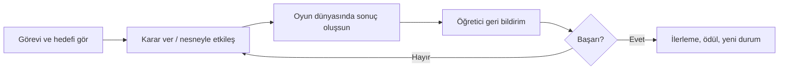

# 05 — Game Design Document (GDD) şablonu

> Bu dosya bir şablondur. Yeni oyun için `docs/games/<game-id>-gdd.md` şeklinde **kopyalayın**. Boş alanlar doldurulmadan geliştirme onayı verilmez.

## A. Kimlik
- **Oyun adı / game_id:** `TODO`
- **GDD sürümü / durumu:** `v0.1 / TASLAK`
- **Oyun ailesi:** `GM-__`
- **Sınıflar / dersler / müfredat sürümleri:** `TODO`
- **Hedef kazanımlar ve kaynak URL'leri:** `TODO (doğrulandı mı?)`
- **Oyun motoru / platform:** `Godot | React/TS | kararsız`
- **İlişkili Öğrenme Merkezi modülü:** `TODO`

## B. Tek cümlede oyun
**Çocuk, [ana etkileşim] yaparak [oyun içi hedefe] ulaşır; böylece [ölçülen beceriyi] uygular.**

## C. Core loop

- **İlk 20 saniye (onboarding):** `TODO`
- **Bir bölümün hedef süresi:** `ÖNERİ, ölçülecek`
- **Kazanma koşulu:** `TODO`
- **Hata ve geri alma:** `TODO`
- **İpucu ve özel ihtiyaçlar:** `TODO`
- **Tekrar oynama motivasyonu:** `TODO`
- **Kesir Atölyesi'nden mekanik farkı:** `TODO`

## D. Pedagoji
| Beceri / kazanım | Oynanıştaki karşılığı | Yanlış cevapta açıklama | Ölçülecek kanıt |
|---|---|---|---|
| TODO | TODO | TODO | TODO |

- Oyun kazanmak ile öğrenme kazanımını **ayrı değerlendir**; yalnızca hız/yıldız akademik başarı olarak sayılmaz.
- Matematik doğruluğu ve aynı bütünün kullanımı gibi alan koşulları açıkça tanımlanır.

## E. Görev ve zorluk veri modeli
- `mission_pack_id`, `level_id`, `grade`, `curriculum_version`, `outcome_ids`, `skill_ids`: `TODO`
- **Kolay / orta / zor örnek görevler:** `TODO`
- **Görsel ipucu ve okuma yükü:** `TODO`
- **Sınıf 2 ile sınıf 4 arasında aynı mekaniğin nasıl uyarlanacağı:** `TODO / bu oyun için uygulanamıyorsa neden?`
- **Her bölümü bitirmenin algoritmik/elle doğrulama yöntemi:** `TODO`

## F. Görseller, ses, UI/UX
- **Görsel referans pano bağlantısı:** `TODO`
- **Karakter / kamera / etkileşimli sahne:** `TODO`
- **Portre Android için oynanış eskizi:** `TODO`
- **Animasyon ve ses bütçesi:** `TODO`
- **Dokunma hedefleri, metin ölçeği, renk dışı geri bildirim:** `TODO`
- **Aşırı uyarım veya başarısızlık cezaları:** `OLMAMALI`

## G. Teknik ve boyut
- **Godot / React kararı ve gerekçesi:** `TODO`
- **Asset listesi (texture, ses, font):** `TODO`
- **Mevcut build boyutu / bu oyundan sonraki build boyutu:** `ÖLÇÜM BEKLENİYOR`
- **Offline çalışması / indirilme stratejisi:** `TODO`
- **Yeni ilerleme event / yıldız anahtarları:** `TODO`
- **Mevcut profil ve bulut veri modeliyle uyum:** `TODO`
- **Güvenlik, çocuk verisi, erişilebilirlik riski:** `TODO`

## H. Vertical slice kabul kriterleri
- [ ] Tek tamamlanabilir oynanış bölümü; yalnızca mock/soru ekranı değil.
- [ ] Gerçek oyun mekaniği ve doğru akademik geri bildirim.
- [ ] Dokunmatik + klavye/fare testleri.
- [ ] Öğrenme Merkezi ve ilerleme bağlantısı.
- [ ] Düşük/orta donanımda performans ve boyut ölçümü.
- [ ] Ekran görüntüsü veya video; hedef yaş pilot test notları.
- [ ] Var olan öğrenme, profil, veri ve diğer oyunlar bozulmadı.

## I. Karar / doğrulama
- **Tasarım onayı:** `BEKLENİYOR`
- **Uygulama sonucu:** `BAŞLAMADI / DEVAM / BLOKE / TAMAMLANDI`
- **Test raporu bağlantısı:** `TODO`
- **Açık problemler ve ertelenen işler:** `TODO`
