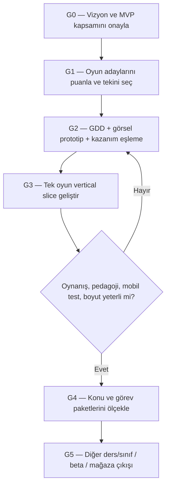

# 06 — Roadmap ve kabul kapıları

**Durum:** v0.1 / tarih-süre tahmini henüz verilmedi.

## Önce ürün kararı, sonra özellik geliştirme



## Mevcut ilerleme (son konuşmalara göre)
| Aşama | Bilinen durum | Eksik / doğrulanacak |
|---|---|---|
| Phase 3.4 | Canlı Supabase OTP, ilk profil sync ve GitHub push agent raporuna göre tamamlandı | İkinci gerçek cihaz ile çift yönlü sync ve tüm hesap güvenliği testleri ayrı kanıtlanmalı; kod gözden geçirmesi yapılmadı |
| Eski Kesir Atölyesi | 10 bölüm içeren oynanabilir prototip | Eğlence ve görsel tasarım yeniden ele alınacak |
| Phase 4.1 — Kesir Köprüsü | Codex'e geliştirme görevi verildi | Sonuç inceleme bekliyor; **yeni oyun stratejisi onaylanmadan nihai ürün kararı sayılmayacak** |
| Yeni ürün tasarım stratejisi | Tartışılıyor | Seçim ve puanlama yapılmadı |

## Kapı (Gate) tablosu
| Gate | Somut teslim | Geçiş şartı | Durum |
|---|---|---|---|
| G0 | Product Vision + PRD + açık kararlar listesi | İlk sürüm sınıfı, dersleri, hedef yaş, başarı ölçütü onaylandı | AÇIK |
| G1 | Game Mechanics Catalog puanları | En güçlü 1 mekanik **kanıt/gerekçeyle** seçildi | AÇIK |
| G2 | Tek oyun için doldurulmuş GDD + storyboard + müfredat eşleme | İlk 1 dakikalık oynanış ve gerçek öğrenme davranışı tanımlı | AÇIK |
| G3 | Gerçek playable vertical slice | Dokunma, pedagoji, temel ilerleme, Android build, ölçülmüş boyut | AÇIK |
| G4 | Konular arası görev paketleri | Aynı sistem en az ikinci gerçek kazanım/sınıf varyantında çalıştı | AÇIK |
| G5 | MVP pilot ve mağaza hazırlığı | Güvenlik, çocuk politikası, performans, kullanılabilirlik testleri | AÇIK |

## Her PR/kod teslimi için 'Done' kontrol listesi
- [ ] Bağlı karar ID / PRD ID / GDD ID belli.
- [ ] Değişikliğin ekranı veya oynanabilir çıktısı var.
- [ ] Birim + entegre + mobil testleri gerçek çalıştırıldı; eksik testler yazıldı.
- [ ] Eski oyun ve oyuncu veri regresyonu kontrol edildi.
- [ ] Eklemeden önce ve sonra APK/AAB/asset boyutları **aynı ölçüm yöntemiyle** raporlandı.
- [ ] Canlı DB/auth ve gerçek kullanıcılara etkisi açıkça yazıldı.
- [ ] Belgeler durum güncellemesiyle tutarlı.
- [ ] Commit, push, deploy ve migration **kullanıcının ayrıca açık onayına** bağlı.

## İlerleme notu şablonu
```text
Tarih:
Görev ve karar ID:
Planlanan:
Gerçekte yapılan:
Test (komut/cihaz):
Ölçülen boyut/perf.:
Kalan sorunlar:
Bir sonraki adım:
Karar: GEÇTİ / BLOKE / EKSİK KANIT
```

**Tasarım politikası:** Kalite kapısını geçmeyen görevi sadece “kod yazıldı” diye kapatmayın. Zaman/kapsam baskısında sistemin eğitim değeri ve çocuk güvenliği önceliklidir.
