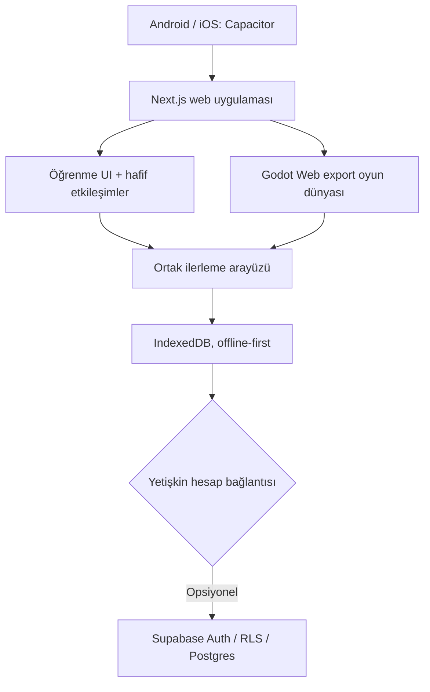

# 08 — Teknik mimari ve uygulama boyutu stratejisi

**Durum:** Var olan mimari kayıtları + bazı öneriler; bu belge kod değişikliği talimatı değildir.

## Çalışan teknoloji temeli
| Bileşen | Teknoloji | Görev |
|---|---|---|
| Oyun motoru | Godot 4 / GDScript | Oyun dünyaları, animasyon, dokunmatik/oyun etkileşimi |
| Web ve öğrenme deneyimi | Next.js 15 / React / TypeScript | İçerik, profil, gelişim ve uygun hafif etkileşimler |
| Mobil kabuk | Capacitor 6 | Android ve iOS paketleme hedefi |
| Yerel veri | IndexedDB | Profil ve ilerlemenin offline-first korunması |
| Yetişkin hesabı / bulut | Supabase Auth + PostgreSQL + RLS | İsteğe bağlı OTP ve eşitleme |

## Hangi oyunu hangi teknolojiyle yaparız? — karar kuralı önerisi
- **Godot:** Gerçek zamanlı sahne, fizik, karakter, çarpışma, animasyon ve cihaz bağımsız oyun döngüsü önemliyse.
- **React/TypeScript:** Bilgi yoğun UI, basit kart/eşleştirme/etkileşim, erişilebilir web bileşeni ve tekrar kullanılabilir öğrenme arayüzü önemliyse.
- **Yeni oyun motoru:** Şu an gerekli olduğuna dair kanıt yok; Phaser gibi ikinci motor eklemeyin.
- Tek oyunu iki motorla geliştirip bakım yükünü büyütmeyin. Seçimi GDD'ye yazın.

## Boyut stratejisi
**Bilinen geçmiş durum:** Eski Android **debug** APK raporuna göre yaklaşık **55 MB**. Bu, güncel release boyutunun veya Google Play üzerinden indirilen MB'ın ölçümü değildir.

**ÖNERİ, onaylanmış bütçe değil:** İlk indirme mümkünse 100 MB altında hedeflenebilir. Gerçek hedef yalnızca örnek release paket + cihaz dağıtımı ve görsel kalite testlerinden sonra kesinleştirilmeli.

### Neleri ayrı ölçmeliyiz?
| Ölçüm | Neden? |
|---|---|
| Android debug APK | Geliştirme regresyonları; mağaza indirme boyutunu temsil etmez |
| Android release AAB + cihaz teslim boyutu | Play Store'a yakın gerçek dağıtım yükü |
| iOS release / IPA | Ayrı motor ve asset paketleme etkisi |
| Web ilk açılış JS + WASM + font + görüntü | Mobil ağ ve ilk açılış deneyimi |
| Her oyun paketi texture/ses | Bir oyun eklendiğinde gerçek MB farkı |
| Cache / offline storage | Cihazdaki toplam kaplanan yer indirmeden büyük olabilir |

### Optimizasyon sırası
1. Her oyunun **gerçek asset envanterini** çıkarın; texture çözünürlüğü/formatı, ses uzunluğu ve font tekrarlarını ölçün.
2. Godot sahne ve kaynaklarını ortaklaştırın; tekrar eden görsel/ses verilerini kopyalamayın.
3. Tek oyun eklemeden **önce/sonra release build** ölçümü yapın.
4. Çok büyürse ileri aşamada içerik paketleri/isteğe bağlı indirme tasarlayın. Bu ayrıca offline önbellek, sürümleme ve platform uyumu gerektirir; bugün mevcut özellik değildir.
5. Düşük/orta donanımlı gerçek Android üzerinde FPS, açılış ve dokunma gecikmesini ölçün.

## Üretim güvenliği
- `.env.local`, servis anahtarları, SMTP anahtarları ve kullanıcı özel verileri repoya konmaz.
- Yeni veri sözleşmesi / migration, hesap güvenliği ve RLS etkisi incelenmeden canlıya uygulanmaz.
- Child-directed uygulama veri ve mağaza politikaları yayımdan önce kontrol edilir.
- iOS için Xcode/TestFlight/cihaz doğrulaması yapılmadan 'hazır' denmez.
