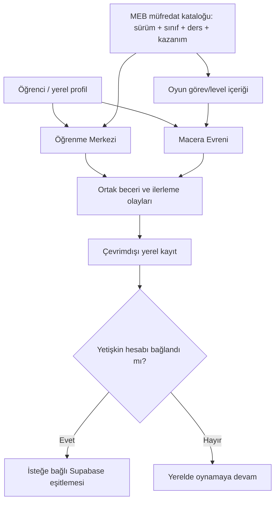

# Ventra — Ürün ve oyun tasarımı belgeleri

**Paket:** v0.1 — 27.10.2026  
**Amaç:** Geliştirmeye başlamadan önce neyi/neden yaptığımızı, neyi henüz kararlaştırmadığımızı ve tamamlanma koşullarını tek yerde tutmak.

> **Bu belgeler taslaktır; tüm kararlar verilmiş değildir.** `KABUL`, `ÖNERİ`, `AÇIK`, `ERTELENDİ` etiketlerini kaldırmadan bunları kesin geliştirme gereksinimi kabul etmeyin.

## Dosya haritası

| Dosya | Ne içerir? |
|---|---|
| [01-product-vision.md](01-product-vision.md) | Ürün kimliği, hedef ve kapsam |
| [02-prd.md](02-prd.md) | Ürün gereksinimleri, kullanıcı akışları ve kalite kriterleri |
| [03-curriculum-matrix.md](03-curriculum-matrix.md) | Sınıf/ders/kazanım eşleme yöntemi ve şablon |
| [04-game-mechanics-catalog.md](04-game-mechanics-catalog.md) | Oyun türü adayları ve karar puanlama yöntemi |
| [05-gdd-template.md](05-gdd-template.md) | Her oyun için doldurulacak oyun tasarım şablonu |
| [06-roadmap.md](06-roadmap.md) | Aşama kapıları, test ve teslim kontrolü |
| [07-decisions.md](07-decisions.md) | Kabul edilen kararlar / açık kararlar / değişiklik günlüğü |
| [08-architecture-and-size.md](08-architecture-and-size.md) | Mevcut teknoloji mimarisi, mobil boyut stratejisi |

## Durum sözlüğü
- **KABUL:** Önceki ürün görüşmelerinde açıkça benimsenen esas; değiştirilirse karar kaydı güncellenir.
- **ÖNERİ:** Önerildi fakat ürün sahibi tarafından henüz son karar verilmedi.
- **AÇIK:** Seçim veya doğrulama bekliyor.
- **ERTELENDİ:** Şimdiki sürümün kapsamında değil.
- **DOĞRULANDI / DOĞRULANMADI:** Çalıştırılmış somut testin sonucu; belgede niyet ile test karıştırılmaz.

## Ürün haritası

## Değişiklik yapma kuralı
1. Yeni kapsam veya oyun önerisi önce `07-decisions.md` içinde **AÇIK** olarak açılır.
2. Seçim kriteri ve kanıt `04-game-mechanics-catalog.md` ya da ilgili GDD'ye eklenir.
3. Onaylandıysa statü **KABUL** yapılır; ardından PRD, müfredat ve roadmap uyarlanır.
4. Kod, ancak tanımlı kabul kriterleri ve onaylı kapsamla yazılır.
5. Her görevin gerçek test sonucu roadmap'e geçirilir. Kodun varlığı tek başına “tamamlandı” değildir.

**Operasyonel sınır:** Bu paket bilgi ve plan dosyasıdır; mevcut uygulamayı, veritabanını, Git geçmişini veya üretim ortamını değiştirmez. Commit/push/deploy/migration ayrı açık onay gerektirir.
