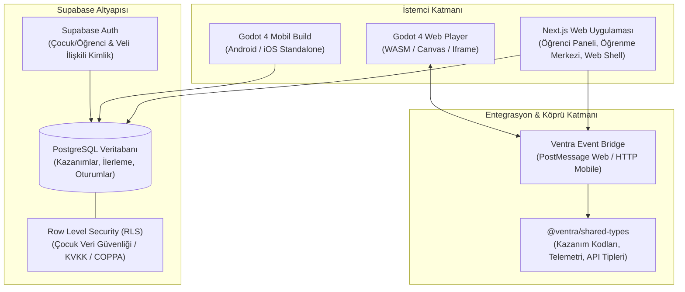

# VENTRA — Sistem Mimarisi, Veri Şeması ve MVP Uygulama Planı (v1.0)

PRD v1.0 gereksinimleri doğrultusunda, geçici veya yüzeysel çözümlere yer vermeksizin, ölçeklenebilir, modüler ve güvenli bir sistem tasarımı hazırlanmıştır.

---

## 1. Sistem ve Monorepo Mimarisi

Ventra üç ana katmandan ve bu katmanların ortak kullandığı sözleşmelerden oluşur:



### Proje Dizin Yapısı (Monorepo)

```text
Ventra/
├── apps/
│   ├── web/                     # Next.js 15 (App Router, Tailwind, TypeScript)
│   │   ├── src/
│   │   │   ├── app/             # Sayfalar: Dashboard, Öğrenme Merkezi, Oyun Alanı
│   │   │   ├── components/      # UI bileşenleri (Ders kartları, interaktif testler, Godot shell)
│   │   │   └── lib/             # Supabase istemcisi, köprü adaptörleri
│   │   └── package.json
│   └── game/                    # Godot 4 Projesi (GDScript)
│       ├── project.godot
│       ├── core/                # Global yöneticiler, EventBus, Telemetry, Bridge
│       ├── worlds/              # Evrenler (Matematik Dünyası vb.)
│       ├── minigames/           # Bağımsız mini oyunlar (Kesir Atölyesi)
│       └── assets/              # Ses, görsel, font ve UI varlıkları
├── packages/
│   └── shared/                  # Ortak TypeScript & JSON şemaları
│       ├── src/
│       │   ├── outcomes.ts      # MEB uyumlu kazanım tanımları
│       │   ├── bridge.ts        # Godot <-> Next.js postMessage protokolü
│       │   └── models.ts        # Veri modelleri ve DTO'lar
│       └── package.json
├── supabase/                    # Supabase konfigürasyonu ve migrasyonlar
│   ├── migrations/              # SQL şemaları ve RLS politikaları
│   └── seed.sql                 # 4. Sınıf Kesirler müfredatı ve başlangıç verileri
├── package.json                 # Monorepo kök konfigürasyonu (npm/pnpm workspaces)
└── README.md
```

---

## 2. Ortak Kazanım (Learning Outcome) Taksonomisi

Öğrenme Merkezi'ndeki testler ile Macera Evreni'ndeki mini oyunların aynı dili konuşması için ortak bir kazanım kodlama sistemi uygulanır:

| Kazanım Kodu | Sınıf | Konu | Alt Beceri | Öğrenme Merkezi Etkinliği | Kesir Atölyesi Oyunu Karşılığı |
|---|---|---|---|---|---|
| `MATH.G4.FRAC.01` | 4. Sınıf | Kesirler | Basit, bileşik ve tam sayılı kesirleri tanıma | Görsel kartlar ve sınıflandırma testi | Düşen kesir balonlarını doğru sepete yerleştirme |
| `MATH.G4.FRAC.02` | 4. Sınıf | Kesirler | Birim kesirleri modelle gösterme | Şekil bölme ve boyama simülatörü | Atölye fırınında pastayı istenen eşit parçalara bölme |
| `MATH.G4.FRAC.03` | 4. Sınıf | Kesirler | Bir çokluğun belirtilen birim kesir kadarını bulma | Adım adım çözümlü problem motoru | İstenen miktarda cevheri raylı vagonlara yükleme |

---

## 3. Veritabanı Şeması (Supabase / PostgreSQL)

Geçici çözümler yerine, ölçeklenebilir ve ilişkisel bütünlüğü koruyan üretim seviyesi şema:

```sql
-- 1. Kazanımlar (Curriculum Outcomes)
CREATE TABLE public.learning_outcomes (
    id TEXT PRIMARY KEY, -- örn: 'MATH.G4.FRAC.01'
    subject TEXT NOT NULL, -- 'math'
    grade INTEGER NOT NULL, -- 4
    unit TEXT NOT NULL, -- 'Kesirler'
    title TEXT NOT NULL,
    description TEXT,
    created_at TIMESTAMPTZ DEFAULT NOW()
);

-- 2. Öğrenci Profilleri
CREATE TABLE public.students (
    id UUID PRIMARY KEY REFERENCES auth.users(id) ON DELETE CASCADE,
    display_name TEXT NOT NULL,
    grade_level INTEGER NOT NULL DEFAULT 4,
    avatar_config JSONB DEFAULT '{}'::jsonb,
    stars_balance INTEGER NOT NULL DEFAULT 0,
    discovery_shards INTEGER NOT NULL DEFAULT 0,
    created_at TIMESTAMPTZ DEFAULT NOW(),
    updated_at TIMESTAMPTZ DEFAULT NOW()
);

-- 3. Öğrenci Kazanım Ustalık Seviyesi (Unified Mastery)
CREATE TABLE public.student_competencies (
    id UUID PRIMARY KEY DEFAULT gen_random_uuid(),
    student_id UUID NOT NULL REFERENCES public.students(id) ON DELETE CASCADE,
    outcome_id TEXT NOT NULL REFERENCES public.learning_outcomes(id) ON DELETE CASCADE,
    mastery_score NUMERIC(5,2) NOT NULL DEFAULT 0.00, -- 0.00 - 100.00
    learning_attempts INTEGER NOT NULL DEFAULT 0,
    learning_correct INTEGER NOT NULL DEFAULT 0,
    gameplay_attempts INTEGER NOT NULL DEFAULT 0,
    gameplay_success INTEGER NOT NULL DEFAULT 0,
    last_evaluated_at TIMESTAMPTZ DEFAULT NOW(),
    UNIQUE(student_id, outcome_id)
);

-- 4. Öğrenme Merkezi Oturumları (Learning Hub Sessions)
CREATE TABLE public.learning_sessions (
    id UUID PRIMARY KEY DEFAULT gen_random_uuid(),
    student_id UUID NOT NULL REFERENCES public.students(id) ON DELETE CASCADE,
    outcome_id TEXT NOT NULL REFERENCES public.learning_outcomes(id),
    total_questions INTEGER NOT NULL,
    correct_answers INTEGER NOT NULL,
    duration_seconds INTEGER NOT NULL,
    stars_earned INTEGER NOT NULL DEFAULT 0,
    completed_at TIMESTAMPTZ DEFAULT NOW()
);

-- 5. Oyun Oturumları (Mini-Game Telemetry & Results)
CREATE TABLE public.game_sessions (
    id UUID PRIMARY KEY DEFAULT gen_random_uuid(),
    student_id UUID NOT NULL REFERENCES public.students(id) ON DELETE CASCADE,
    game_id TEXT NOT NULL, -- 'fraction_workshop'
    world_id TEXT NOT NULL, -- 'math_world'
    level_id INTEGER NOT NULL,
    outcome_id TEXT NOT NULL REFERENCES public.learning_outcomes(id),
    score INTEGER NOT NULL DEFAULT 0,
    success BOOLEAN NOT NULL DEFAULT false,
    stars_earned INTEGER NOT NULL DEFAULT 0,
    shards_earned INTEGER NOT NULL DEFAULT 0,
    metrics JSONB DEFAULT '{}'::jsonb, -- Süre, hamle sayısı, hata türleri
    played_at TIMESTAMPTZ DEFAULT NOW()
);
```

---

## 4. Godot 4 <-> Next.js Köprü Sözleşmesi (Bridge Protocol)

Web üzerinde Godot, Next.js içinde izole bir `iframe` ya da HTML5 Canvas katmanında çalışır. İki yönlü haberleşme katı tipli mesajlarla sağlanır:

```typescript
// packages/shared/src/bridge.ts

export type VentraBridgeEvent =
  // Godot -> Web
  | { type: 'VENTRA_GAME_READY'; payload: { gameId: string; version: string } }
  | { type: 'VENTRA_GAME_LEVEL_COMPLETED'; payload: GameResultPayload }
  | { type: 'VENTRA_REQUEST_USER_SESSION' }
  // Web -> Godot
  | { type: 'VENTRA_INIT_GAME'; payload: { studentId: string; language: 'tr'; settings: GameSettings } }
  | { type: 'VENTRA_SYNC_PROGRESS'; payload: { stars: number; shards: number } };

export interface GameResultPayload {
  gameId: string;
  outcomeId: string;
  level: number;
  score: number;
  success: boolean;
  accuracy: number;
  metrics: {
    durationSec: number;
    wrongAttempts: number;
  };
}
```

Godot tarafında `JavaScriptBridge` (HTML5 export için) veya native HTTP istemcisi (Android/iOS standalone için) kullanılarak platformdan bağımsız tekil bir `NetworkManager.gd` arayüzü sunulur.

---

## 5. İlk MVP (Vertical Slice) Aşamalı Eylem Planı

1. **Aşama 1: Monorepo & Altyapı İskeleti**
   - Workspace yapısının kurulması (`apps/web`, `apps/game`, `packages/shared`).
   - Shared paketinin oluşturulması (TypeScript tanımları ve kazanım sözlüğü).
   - Supabase şemasının hazırlanması ve migrasyonların tanımlanması.

2. **Aşama 2: Öğrenme Merkezi (4. Sınıf Kesirler)**
   - Kesirler konu anlatımı bileşenleri (Birim kesir, basit/bileşik kesir modellemeleri).
   - İnteraktif adım adım çözümlü örnek modülü.
   - 5 soruluk alıştırma testi ve sonuçların `student_competencies` tablosuna aktarılması.

3. **Aşama 3: Godot 4 Macera Evreni & Kesir Atölyesi**
   - Godot 4 2D sahne yapısı (Hub ekranı ve Kesir Atölyesi mini oyunu).
   - Kesir Atölyesi temel oynanışı: Verilen kesri modelleme / bölme mekaniği.
   - Seviye bitişi ve telemetri verisi üretimi.

4. **Aşama 4: Ortak Köprü & Gelişim Ekranı**
   - Next.js Web Shell içine Godot entegrasyonu ve PostMessage EventBus bağlantısı.
   - Öğrencinin tek bir ekranda hem Öğrenme Merkezi hem Kesir Atölyesi'nden kazandığı başarı/yıldız ve ortak kazanım ustalığını görüntülemesi.
   - Sayfa yenilendiğinde verinin Supabase'den kalıcı olarak gelmesinin doğrulanması.
