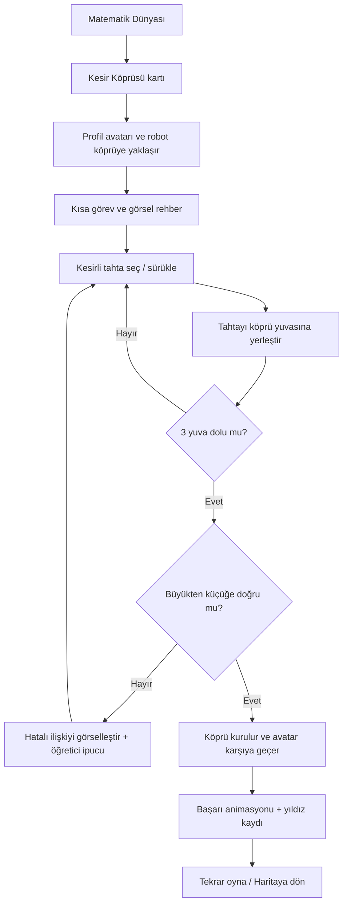

# Oyuncu akışı ve ekran taslakları

## Oyuncu akışı (Mermaid)



## Ekran A — Oyun seçimi

- Mevcut Matematik Dünyası seçim ekranı korunur ancak kart içinde **oyunun gerçek sahnesini gösteren** tutarlı görsel/thumbnail kullanılır.
- Kesir Köprüsü = oyun adı, kısa vaadi, kazanım, ilerleme, belirgin `Başla`.
- Eski Kesir Atölyesi = bir eğitim uygulaması prototipi olarak yeniden konumlandırılması ayrı karar; bu vertical slice kapsamına girmez.

## Ekran B — Kısa başlangıç

- Arka planda ana sahne görünür (modal arkasında boş mavi alan değil).
- Robot tek cümle konuşur; odağı karartıp uzun anlatım gösterme.
- Çocuğun seçtiği avatar görünür, uygun fallback avatar tasarımı olabilir.

## Ekran C — Asıl oyun, masaüstü / yatay

```text
┌───────────────────────────────────────────────────────────────────────────┐
│ [←] Bölüm 1/10          Tahtaları büyükten küçüğe sırala       [🔈] [Ⅱ] │
│                                                                           │
│    SOL ADA                                 HEDEF ADA                       │
│   [Avatar]   [3 yuva / eksik köprü]                         [Bayrak]     │
│   [Robot]   ═══ ┄┄┄ ┄┄┄ ════                                          │
│                    [Su / şelale / derinlik hissi]                        │
│                                                                           │
│        Ahşap parçalar:    [1/4]       [1/2]       [1/3]                 │
│                           (görünür uzunlukları kesre göre farklı)        │
│                                   [İpucu ?]                              │
└───────────────────────────────────────────────────────────────────────────┘
```

**Ana alanın %60–70'i oynanabilir sahne.** HUD sade, oyun dünyasının görsel hiyerarşisini bastırmaz.

## Ekran C — Mobil dikey (zorunlu birinci sınıf tasarım)

```text
┌────────────────────────────┐
│ [←]    Bölüm 1    [🔈][Ⅱ]│
│   Büyükten küçüğe sırala  │
│                            │
│         HEDEF ADA [🚩]    │
│           ╱ Yuva 3        │
│         ╱   Yuva 2        │
│       ╱     Yuva 1        │
│ [Avatar/Robot] BAŞLANGIÇ  │
│   şelale / adalar          │
│────────────────────────────│
│ Sürükle:  [1/4] [1/2] [1/3]│
│ [İpucu]    [Geri Al]      │
└────────────────────────────┘
```

**Mobilde köprü sahnesi çapraz/yukarı ilerleyen bir kompozisyonla yeniden kadrajlanır.** Masaüstü ekranı küçültülerek geçiştirilemez. Aynı mantıksal sıra, **başlangıçtan hedefe büyükten küçüğe** yönünde korunur; masaüstünde soldan sağa, dikeyde alttan yukarı görülebilir. Avatar dokunmatik hedefleri örtmez.

### Responsive hedefler

- Test cihaz profilleri: 360×800, 390×844, 412×915 (dikey) ve 1280×720 (yatay/desktop).
- Yatay kaydırma yok, HUD oyun alanını boğmaz.
- Güvenli alanlar, ekran çentiği ve alt sistem çubuğu hesaba katılır.
- Etkileşim hedefleri en az yaklaşık 44–48 CSS px / mantıksal dp eşdeğeri; görünür plank genişliği ile hitbox boyutu ayrı yönetilir.
- Metinler ve butonlar çocuk için büyük ve okunur olmalı, detay birincil sahne üzerine birikmemeli.

## Ekran D — Hata anı

Köprü kalaslarında ilk yanlış sıralanan komşu çift hafif vurgulanır; robot açıklaması 1–2 satır; oyuncu aynı sahnede hemen düzeltir. Tam ekran hata modalı veya cezalandırıcı ses yok.

## Ekran E — Kazanma

- Köprü parçaları bağlanır; yürünebilir yol görsel olarak oluşur.
- Avatar robotla otomatik karşıya ilerler (hareket gerçek köprü yüzeyinin üzerinden geçmeli).
- Sonuç paneli: üç yıldız, `Tekrar Oyna`, `Haritaya Dön`. Arka plan hâlâ oyunu gösterir.
- Kazanılan yıldızlar görsel şovdan bağımsız olarak mevcut veri katmanına güvenli biçimde kaydedilir.

## Referans

`references/kesir-koprusu-concept-reference.png`: **Yön/estetik referansı**, bitmiş ekran veya doğru matematik örneği diye kullanılmaz. Üzerindeki yazı/etiketleri otomatik kopyalama: matematik mantığının tek kaynağı bu GDD'dir.
