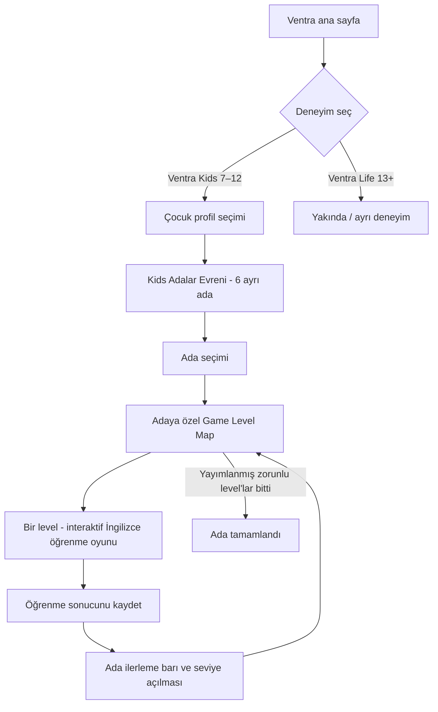

# VENTRA — ONAYLANAN ÜRÜN AKIŞI

## Ada etkileşim gereksinimi

- Her ada aynı dünya içindeki bağımsız varlık: `islandId`, texture(s), polygon hitbox, zoom target, lock state, progress state.
- Haritadaki ada gerçekten seçilebilir: hover/tap highlight, odak/zoom, görünür ve erişilebilir bölge adı, ardından Game Level Map.
- Ada altındaki progress bar'ın kesin ölçüsü: `completedRequiredLevels / totalPublishedRequiredLevels` — ders sayısı sonradan arttığında durum ve sürüm semantiği tasarlanmalı.
- Kilit açma, göreve devam, tekrar oynama, ödül idempotency, profil ayrımı ve offline kayıt testlenmeli.
- Her ada İngilizcenin farklı öğretim alanına odaklanır; sadece sınav ekranı tekrarları olmasın.

## Ada rolleri — başlangıç önerisi, müfredat onayı değil

1. `word_garden`: kelime bilgisi.
2. `listening_forest`: dinleme.
3. `speaking_harbor`: diyalog/konuşma (mikrofon V1'de yok).
4. `sentence_workshop`: cümle kurma ve yazma.
5. `story_castle`: okuma/hikâyeler.
6. `language_academy`: dilbilgisi/tekrar (öneri).

## İlk dikey dilim ve mevcut yatırımlar

Mevcut 5 öğrenme etkileşimini silme. Kelime Adası Level Map'i ile nasıl eşleneceği gerçek kodu inceleyerek belirlenmeli: her eski *activity*'yi otomatik olarak bağımsız bir *level* sayma. İçerik/quiz/attempt/progress modelinde doğru kimlikler tanımlansın. İlk gerçek E2E: `/` → `/kids` → Kelime Adası → Level Map → mevcut bir öğrenme etkinliği → ödül → ada barı → yeniden yükleme.

Not: Altı adanın hepsinin dersleri bu ilk fazda yapılmayacak.
