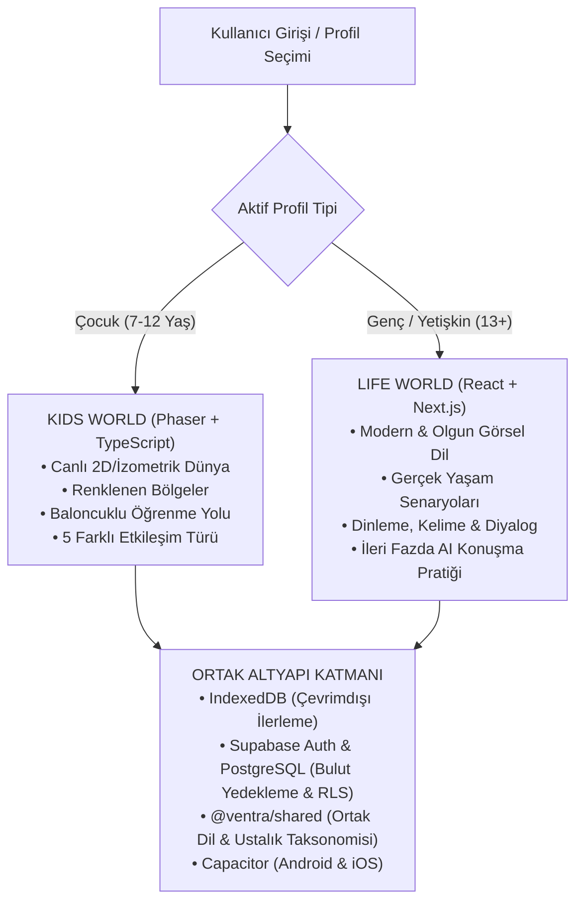

# VENTRA — DİL ÖĞRENME PLATFORMU V1
## 01: Ürün Vizyonu ve Ürün Gereksinim Dokümanı (PRD)

---

## 1. Ürün Kimliği ve Vizyon Bildirisi

**Ventra**, kullanıcıların yeni bir dil öğrenirken etkileşimli görevler tamamladığı, başarıyla tamamlanan her dersle birlikte kendi canlı dünyalarını görsel olarak geliştirip dönüştürdüğü, oyunlaştırılmış yeni nesil bir dil öğrenme platformudur.

Geleneksel dil öğrenme uygulamaları çoğunlukla kullanıcıyı mekanik kelime ezberlerine ve monoton çoktan seçmeli test kalıplarına hapsederken; Ventra dil edinimini **keşfedilebilir bir dünya macerasının anahtarı** haline getirir. 

### Temel Ürün İlkeleri:
1. **Dil Öğrenmek Birincil Amaçtır:** Oyun mekanikleri dil öğrenmeyi eğlenceli ve sürdürülebilir kılmak için birer kaldıraçtır. Kullanıcı asla dil öğrenmeyi unutturan karmaşık envanter yönetimi, kaynak savaşı veya şehir kurma simülasyonlarıyla meşgul edilmez.
2. **Dünya Gelişimi = Pedagojik Ödül:** Kullanıcı bir dil becerisini kazandığında ve görevi tamamladığında, içinde bulunduğu dünya veya bölge gözle görülür biçimde serpilir, renklenir, çiçek açar veya onarılır. Öğrenme çabası somut bir görsel sonuca dönüşür.
3. **Çoktan Seçmeli Soru Kısırlığına Son:** Dil; yalnızca A/B/C/D şıklarına basarak öğrenilmez. Görseli tanıma, duyma, iki yönlü eşleme, sahne içi nesneleri yönergeye göre hareket ettirme ve bağlamsal görevleri çözme gibi aktif motor ve bilişsel etkileşimler kullanılır.
4. **Yaşa Özel İkili Deneyim:** Çocuklar ile genç/yetişkinlerin motivasyon kaynakları farklıdır. 7–12 yaş grubu renkli, karakter odaklı bir oyun dünyasında (Kids World) öğrenirken; 13+ yaş grubu gerçek hayat senaryolarına odaklanan sofistike bir arayüzde (Life World) ilerler.
5. **Ölçülebilir ve Kanıta Dayalı İlerleme:** Öğrencinin "başarılı" kabul edilmesi rastlantısal tek bir doğru cevaba değil; dinleme, anlama ve uygulama adımlarını içeren kanıta dayalı yeterlilik sistemine (evidence-based mastery) dayanır.
6. **Platformlar Arası Eşit Deneyim:** Ürün Web, Android ve iOS ortamlarında aynı veri tabanı, aynı çevrimdışı çalışma kabiliyeti ve yüksek akıcılıkta çalışır.

---

## 2. Hedef Kullanıcı Segmentleri ve Personalar

| Persona | Yaş Grubu | Motivasyon ve İhtiyaçlar | Karşılaşılan Zorluklar | Ventra Çözümü |
| :--- | :---: | :--- | :--- | :--- |
| **Kaşif Çocuk (Can, 9)** | 7–12 | Oyun oynamayı, çizgi filmleri, hayvanları ve keşfetmeyi sever. | Sıkıcı ders kitapları ve soyut dilbilgisi kuralları dikkatini dağıtır; çabuk sıkılır. | **Kids World:** Renkli 2D Phaser dünyası, baloncuklu bölüm yolları, dokunmatik görevler ve tamamlanan derslerle renklenen canlı bölgeler. |
| **Genç / Yetişkin (Selin, 19)** | 13+ | Yurt dışı seyahati, dizi/film anlama veya okul/kariyer için pratik İngilizce ister. | Çocuksu görsellerden ve gerçek hayatta kullanılmayan anlamsız cümlelerden rahatsız olur. | **Life World:** Gerçek yaşam senaryoları (kafe, havaalanı, tanışma), modern React arayüzü, dinleme ve diyalog odaklı hızlı pratikler. |
| **Bilinçli Ebeveyn (Murat, 41)** | Yetişkin | Çocuğunun ekranda geçirdiği sürenin gerçekten eğitici ve güvenli olmasını ister. | Uygulama içi kontrolsüz harcamalar, reklamlar ve çocuk verisinin izinsiz toplanması endişesi. | **Ebeveyn Kapısı & Anonim Profil:** Çocuktan sıfır kişisel veri toplanması, çarpma kapılı ebeveyn alanı ve cihazlar arası güvenli Supabase bulut yedeklemesi. |

> [!NOTE]
> Yaş seçimi katı bir kimlik doğrulaması değildir; pedagojik ve görsel deneyim tercihidir. Ebeveyn ve çocuk güvenliği, kişisel verilerin korunması kanunları (COPPA, KVKK, GDPR) gereğince profil seviyesinde tam izolasyonla sağlanır.

---

## 3. Ürün Mimarisi ve İki Temel Deneyim

### A. Kids World (7–12 Yaş)
* **Teknoloji:** Phaser 3 + TypeScript (Iframe olmaksızın doğrudan React DOM içine gömülü).
* **Görsel Dil:** Canlı, yüksek kontrastlı, yumuşak hatlara sahip çocuk dostu 2D/izometrik illüstrasyonlar.
* **Ana Deneyim:** 
  * Kullanıcı ana dünyadaki bölgeleri keşfeder.
  * Henüz çalışılmamış bölgeler solgun/uykudadır.
  * Bölgeye tıklandığında eğlenceli bir geçiş animasyonuyla öğrenme yoluna (baloncuklu haritaya) girilir.
  * Dersler tamamlandıkça kazanılan yıldızlar ve tohumlar/kıvılcımlarla bölge canlanır ve yeni bölgelerin yolu açılır.

### B. Life World (13+ Yaş)
* **Teknoloji:** Next.js 15 + React 19 + TypeScript.
* **Görsel Dil:** Modern, minimalist, koyu ve açık tema destekli, yetişkin eğitim standartlarına uygun tasarım.
* **Ana Deneyim:** 
  * Gerçek yaşam bağlamları: "Kahve Siparişi Verme", "Otel Rezervasyonu", "Yol Tarifi İsteme".
  * Hızlı kartlar, bağlamsal kelime eşleştirme, telaffuz dinleme ve cümle kurma egzersizleri.
  * İlerleyen aşamalarda LLM tabanlı yapay zeka ile etkileşimli diyalog simülasyonu.

---

## 4. Kapsam ve Yol Haritası Sınırları

### A. MVP / İlk Vertical Slice (V1) Kapsamı:
* Giriş ve profil seçimi (mevcut çalışan sistem).
* Çocuk dünyasının **tek bir başlangıç bölgesi** (Örnek: *Kelime Bahçesi*).
* Başlangıç bölgesine geçiş animasyonu.
* **5 düğümlü bir öğrenme yolu** (baloncuklu harita).
* **5 farklı öğrenme etkileşimi** (Keşfet, Eşleştir, Dinle, Uygula, Mini Görev).
* Başarı ekranı ve bölgenin dünyada görsel olarak gelişmesi.
* İlerlemenin IndexedDB'ye ve Supabase bulutuna yazılması.
* *Life World (13+) V1'de yalnızca mimari ve akış düzeyinde tanımlanır; kod geliştirmesi V2'ye bırakılır.*

### B. Uzun Vadeli Kapsam (V2 ve Sonrası):
* Life World 13+ modülünün tam uygulaması.
* Kids World için çoklu bölgeler (Ada, Orman, Gökyüzü Köyü, Antik Kütüphane).
* Web Audio API ile telaffuz kaydı ve yapay zeka destekli telaffuz değerlendirmesi.
* Ebeveyn detaylı ilerleme raporları ve haftalık e-posta özeti.
* Sosyal öğrenme, sınıf modları ve öğretmen panelleri.

---

## 5. Başarı Ölçütleri ve KPI'lar

1. **Pedagojik Başarı (Learning Efficacy):**
   * **Ders Tamamlama Oranı (Completion Rate):** Öğrenme yoluna giren kullanıcıların en az **%85'inin** 5 adımı tamamlaması.
   * **Kelime Kalıcılığı (Retention Rate):** 7 gün sonra aralıklı tekrar (SRS) testinde kelimelerin en az **%75** doğrulukla hatırlanması.
2. **Kullanıcı Bağlılığı (Engagement):**
   * **D1 / D7 Retention:** Yeni kullanıcıların 1. gün tekrar geliş oranının **>%45**, 7. gün geliş oranının **>%25** olması.
   * **Ortalama Oturum Süresi:** Çocuk kullanıcılar için günlük 8–15 dakika arası odaklı öğrenme süresi.
3. **Teknik Başarı (Technical Health):**
   * **Sıfır Çökme (Crash-free Sessions):** Web ve mobil WebView oturumlarında **>%99.5** çökmesiz çalışma oranı.
   * **Hafif Paket Boyutu:** Android APK boyutunun 15 MB altında kalması (eski Godot sürümünün üçte biri).
   * **Çevrimdışı Güvenilirlik:** İnternet yokken kaydedilen ilerleme etkinliklerinin ilk bağlantıda **%100 kayıpsız** buluta aktarılması.

