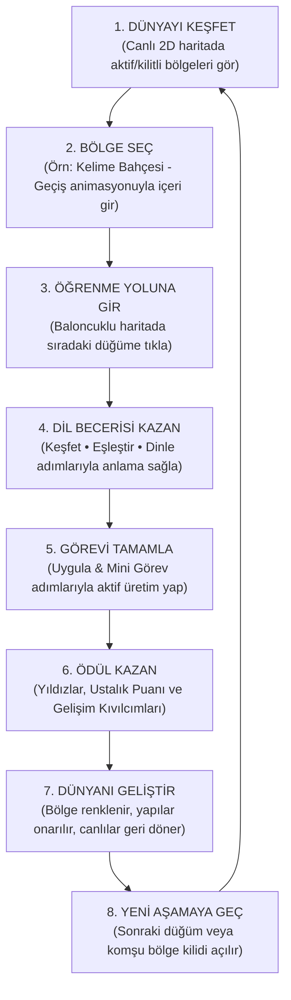
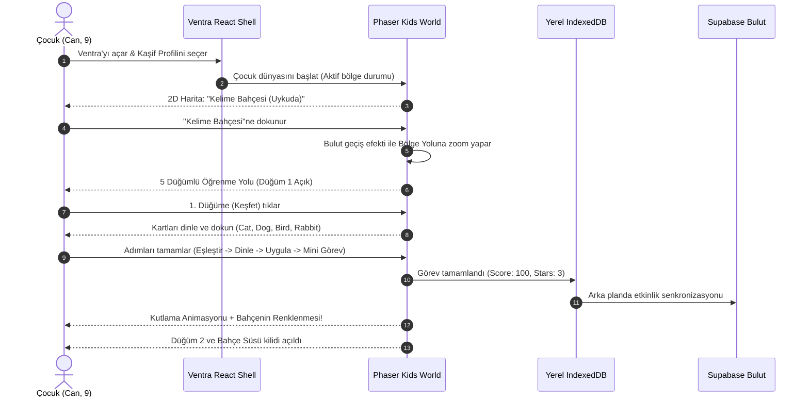
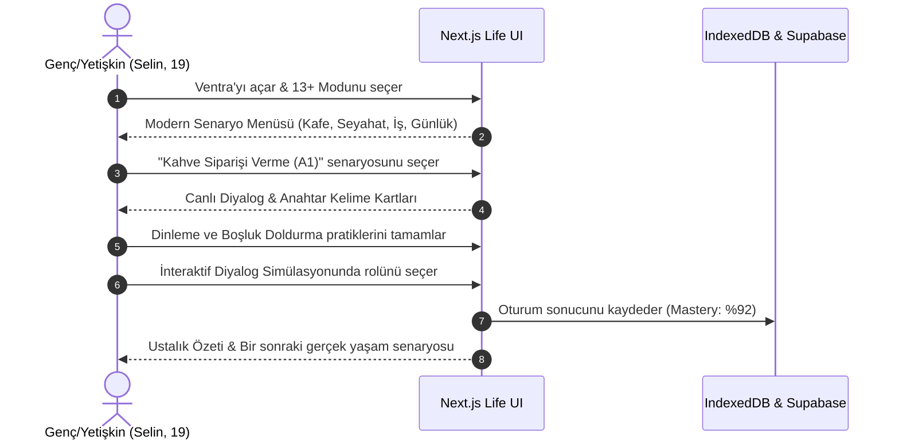

# VENTRA — DİL ÖĞRENME PLATFORMU V1
## 02: Kullanıcı Yolculukları ve Arayüz Taslakları (Wireframes)

---

## 1. Temel Ürün Döngüsü (The Core Product Loop)

Ventra'nın pedagojik ve oyunlaştırılmış mimarisi tek bir merkezî döngü etrafında inşa edilmiştir:



### Döngünün Adım Adım Açıklaması:
1. **Dünyayı Keşfet:** Kullanıcı ana ekranda yaşayan haritayı görür. Henüz çalışılmamış bölgeler pastel/sisli, tamamlanmış bölgeler ise canlı ve hareketlidir.
2. **Bölge Seç:** Kullanıcı dokunarak çalışmak istediği bölgeyi seçer. Akıcı bir kamera yaklaşması veya bulut açılma animasyonu oynatılır.
3. **Öğrenme Yoluna Gir:** Bölge açıldığında adım adım açılan bir "öğrenme patikası" (düğümlü baloncuklar) görüntülenir.
4. **Dil Becerisi Kazan:** Kullanıcı ilk düğümlerde yeni kelimeleri ve sesleri görür, dokunur, dinler ve görselle bağ kurar.
5. **Görevi Tamamla:** Sonraki düğümlerde çoktan seçmeli test yerine nesneleri sürükleyerek veya yönergeleri uygulayarak görevi çözer.
6. **Ödül Kazan:** Görev tamamlandığında başarı konfetileri, 1–3 yıldız ve bölgeyi besleyecek "Gelişim Kıvılcımları" kazanılır.
7. **Dünyanı Geliştir:** Kazanılan ödüller bölgeye aktarılır; gri alan renklenir, bahçede çiçekler açar veya bir bina restore edilir.
8. **Yeni Aşamaya Geç:** Bir sonraki düğümün kilidi yumuşak bir ışıkla açılır; kullanıcı döngüyü sürdürür.

---

## 2. Kullanıcı Deneyimi Yolculukları (User Journeys)

### A. Kids World (7–12 Yaş) Uçtan Uca Akışı



### B. Life World (13+ Yaş) Kullanıcı Akışı



---

## 3. Ekran Bazında Metinsel Wireframe'ler (Mobil & Masaüstü)

### Wireframe 1: Karşılama ve Deneyim/Profil Seçim Ekranı

Bu ekran, uygulamanın ana kapısıdır. Mevcut güvenli profil sistemi burada korunur.

```text
+-------------------------------------------------------------+
| [🧭 Ventra Logosu]                        [🛡️ Ebeveyn Alanı] |
+-------------------------------------------------------------+
|                                                             |
|                 MACERAYA HOŞ GELDİN!                        |
|             Kim olarak oynamak istersin?                    |
|                                                             |
|   +-----------------------+     +-----------------------+   |
|   |      [🧭 KAŞİF]       |     |     [🦉 BAYKUŞ]       |   |
|   |         Can           |     |        Ayşe           |   |
|   |     (7-12 Yaş)        |     |     (7-12 Yaş)        |   |
|   |    [Dünyaya Gir]      |     |    [Dünyaya Gir]      |   |
|   +-----------------------+     +-----------------------+   |
|                                                             |
|   +-----------------------------------------------------+   |
|   |            [✨ YETİŞKİN / 13+ DİL MODU]              |   |
|   |   Daha olgun, gerçek yaşam senaryoları ve diyaloglar|   |
|   |                   [Giriş Yap]                       |   |
|   +-----------------------------------------------------+   |
|                                                             |
|               [+ Yeni Çocuk Profili Ekle]                   |
+-------------------------------------------------------------+
```

---

### Wireframe 2: Kids World — Ana Dünya Haritası

Phaser 3 tarafından render edilen, dokunmatik ve canlı ana keşif ekranı.

```text
+-------------------------------------------------------------+
| [👤 Can (Kaşif)]   ⭐ 12 Yıldız   ✨ 45 Kıvılcım   [⚙️ Ayarlar] |
+-------------------------------------------------------------+
|                                                             |
|      ☁️                    ☁️                     ☁️        |
|                                                             |
|            +----------------------------+                   |
|            |    [🌸 KELİME BAHÇESİ]     |                   |
|            |    Durum: Seviye 1 (%20)   |                   |
|            |    "Dokun ve İncele!"      |                   |
|            +----------------------------+                   |
|                                                             |
|         ~~~~~~~~~~~~~~~~ (Nehir) ~~~~~~~~~~~~~~~~           |
|                                                             |
|   +--------------------+            +-------------------+   |
|   |  [🔒 SES ORMANI]   |            |  [🔒 SAYI KÖYÜ]   |   |
|   | 3 Bölüm Sonra Açık |            | 6 Bölüm Sonra Açık|   |
|   +--------------------+            +-------------------+   |
|                                                             |
| [🗺️ Dünya Haritası]      [🎒 Çanta / Rozetler]     [📊 Gelişim] |
+-------------------------------------------------------------+
```

---

### Wireframe 3: Kids World — Bölge Öğrenme Yolu (Baloncuklu Patika)

Bölgeye tıklandığında yumuşak bir kamera hareketiyle açılan seviye seçim haritası.

```text
+-------------------------------------------------------------+
| [← Haritaya Dön]       🌸 KELİME BAHÇESİ        [💡 Günün Görevi] |
+-------------------------------------------------------------+
|                                                             |
|                       (Hedef Ada)                           |
|                            |                                |
|                     [ (5) MİNİ GÖREV ] (🔒)                 |
|                            |                                |
|                     [ (4) UYGULA ]    (🔒)                 |
|                            |                                |
|                     [ (3) DİNLE ]     (🔒)                 |
|                            |                                |
|                     [ (2) EŞLEŞTİR ]  (🔒)                 |
|                            |                                |
|                  ⭐ [ (1) KEŞFET ]    (AKTİF / PARLIYOR)   |
|                            |                                |
|                     [ Kaşif Karakter ]                      |
|                                                             |
|  +-------------------------------------------------------+  |
|  | Görev: "Hayvanları tanı ve bahçeye hayat ver!"        |  |
|  | Konu: A1 Başlangıç • Evcil Hayvanlar                  |  |
|  |                 [ BÖLÜME BAŞLA ▶ ]                    |  |
|  +-------------------------------------------------------+  |
+-------------------------------------------------------------+
```

---

### Wireframe 4: Kids World — 5 Farklı Öğrenme Adımı Ekranları

#### Adım 1: Keşfet (Gör ve Dinle)
Kullanıcı kartlara dokunur, yüksek kaliteli ses dinler, görsel büyür.

```text
+-------------------------------------------------------------+
| [✖ Çıkış]             ADIM 1 / 5: KEŞFET           [🔊 Tekrar] |
+-------------------------------------------------------------+
|                                                             |
|               "Karta dokun ve nasıl söylendiğini duy!"      |
|                                                             |
|        +---------------+               +---------------+    |
|        |     🐱        |               |      🐶       |    |
|        |     CAT       |               |      DOG      |    |
|        |  [🔊 Dinle]   |               |   [🔊 Dinle]  |    |
|        +---------------+               +---------------+    |
|                                                             |
|        +---------------+               +---------------+    |
|        |     🐦        |               |      🐰       |    |
|        |     BIRD      |               |     RABBIT    |    |
|        |  [🔊 Dinle]   |               |   [🔊 Dinle]  |    |
|        +---------------+               +---------------+    |
|                                                             |
|                     [ TÜMÜNÜ DİNLEDİM ✓ ]                   |
+-------------------------------------------------------------+
```

#### Adım 2: Eşleştir (İki Yönlü Eşleme)
Sürükle-bırak veya dokun-seç yöntemiyle resim ile kelime bağlanır.

```text
+-------------------------------------------------------------+
| [✖ Çıkış]            ADIM 2 / 5: EŞLEŞTİR          [💡 İpucu] |
+-------------------------------------------------------------+
|                                                             |
|              "Resimleri doğru kelimelerle birleştir!"       |
|                                                             |
|     (Görseller)                              (Kelimeler)    |
|     +---------+                              +---------+    |
|     |   🐶    | ---------[Bağlantı Çizgisi]- |  "DOG"  |    |
|     +---------+                              +---------+    |
|     +---------+                              +---------+    |
|     |   🐱    |                              |  "BIRD" |    |
|     +---------+                              +---------+    |
|     +---------+                              +---------+    |
|     |   🐦    |                              |  "CAT"  |    |
|     +---------+                              +---------+    |
|                                                             |
|             (Kullanıcı dokundukça ses anında çalar)         |
+-------------------------------------------------------------+
```

#### Adım 3: Dinle (Duyduğunu Tanı)
Ses çalınır; kullanıcı sahnedeki doğru nesneye dokunur.

```text
+-------------------------------------------------------------+
| [✖ Çıkış]              ADIM 3 / 5: DİNLE           [🔊 Oynat] |
+-------------------------------------------------------------+
|                                                             |
|                        [ 🔊 "RABBIT" ]                      |
|                  "Duyduğun hayvan hangisi?"                 |
|                                                             |
|      +-------------+   +-------------+   +-------------+    |
|      |     🐱      |   |     🐰      |   |     🐦      |    |
|      |    (Kedi)   |   |   (Tavşan)  |   |     (Kuş)   |    |
|      +-------------+   +-------------+   +-------------+    |
|                                                             |
|   (Doğru seçildiğinde konfeti efekti & kelimenin okunuşu)   |
+-------------------------------------------------------------+
```

#### Adım 4: Uygula (Yönergeyi Tamamla)
Kullanıcı basit bir İngilizce talimatı ekranda uygular (Test sorusu değil, eylem!).

```text
+-------------------------------------------------------------+
| [✖ Çıkış]             ADIM 4 / 5: UYGULA           [🔊 Oku]   |
+-------------------------------------------------------------+
|                                                             |
|               YÖNERGE: "Feed the cat with milk!"            |
|                                                             |
|            +---------+                   +---------+        |
|            |   🥛    | ====== sürükle => |   🐱    |        |
|            |  Milk   |                   |   Cat   |        |
|            +---------+                   +---------+        |
|                                                             |
|   (Doğru verildiğinde: Kedi sevinir, miyavlar ve "Thank you!" der)|
+-------------------------------------------------------------+
```

#### Adım 5: Mini Görev (Bahçeyi Geliştir)
Öğrenilen tüm kelimeler bahçedeki yuvalara yerleştirilir; bahçe uyanır.

```text
+-------------------------------------------------------------+
| [✖ Çıkış]           ADIM 5 / 5: MİNİ GÖREV         [⭐ 3/3]   |
+-------------------------------------------------------------+
|                                                             |
|      "Kuşu ağaca, tavşanı çimenlere, kediyi kulübeye koy!"  |
|                                                             |
|                   [ 🌳 Ağaç Yuvası: ? ]                     |
|                                                             |
|   [ 🏠 Kulübe: ? ]                      [ 🌿 Çimen: ? ]     |
|                                                             |
|  ---------------------------------------------------------  |
|    Seçenek Havuzu:   [ 🐱 Cat ]   [ 🐦 Bird ]   [ 🐰 Rabbit ] |
|  ---------------------------------------------------------  |
+-------------------------------------------------------------+
```

---

### Wireframe 5: Kids World — Başarı ve Dünya Gelişim Ekranı

Ders bittiğinde kazanılan ödüller gösterilir ve haritadaki değişim animasyonla izletilir.

```text
+-------------------------------------------------------------+
|                                                             |
|                      🎉 HARİKA İŞ! 🎉                       |
|                 Kelime Bahçesi Seviye 1 Açıldı!             |
|                                                             |
|                          ⭐⭐⭐                             |
|                        100 Puan                             |
|                 +15 Gelişim Kıvılcımı                       |
|                                                             |
|       +---------------------------------------------+       |
|       |             [CANLANMA ANİMASYONU]           |       |
|       |  Gri bahçe yeşillenir, çiçekler açar ve    |       |
|       |     hayvanlar bahçede oynamaya başlar!      |       |
|       +---------------------------------------------+       |
|                                                             |
|              Öğrenilen Beceriler: cat, dog, bird, rabbit    |
|                                                             |
|      [ 🔄 Tekrar Oyna ]               [ 🗺️ Haritaya Dön ▶ ]  |
|                                                             |
+-------------------------------------------------------------+
```

---

### Wireframe 6: Life World (13+) — Senaryo ve Alıştırma Ekranı

Modern, minimalist ve yetişkin odaklı React arayüzü.

```text
+-------------------------------------------------------------+
| [Ventra Life]     Dersler   Pratik   Kelime Defteri   [Profil] |
+-------------------------------------------------------------+
|                                                             |
|  ☕ KAHVE SİPARİŞİ VERME (A1 Seviye)        İlerleme: %65    |
|  ---------------------------------------------------------  |
|                                                             |
|  Garson: "Hello! What can I get for you today?"             |
|  [🔊 Dinle]                                                 |
|                                                             |
|  Senin Yanıtın:                                             |
|  "I would like a ________ coffee, please."                  |
|                                                             |
|  Kelime Seçenekleri:                                        |
|  [ small ]      [ chair ]      [ tomorrow ]                 |
|                                                             |
|  💡 Kültürel İpucu: "I would like..." kalıbı İngilizce      |
|  sipariş verirken en kibar ve yaygın ifadedir.              |
|                                                             |
|  ---------------------------------------------------------  |
|  [ Kontrol Et ]                                [ Sonraki ▶ ] |
+-------------------------------------------------------------+
```

