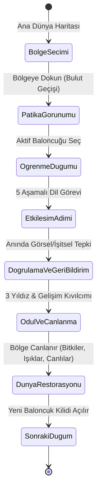

# VENTRA — DİL ÖĞRENME PLATFORMU V1
## 03: Çocuk Dünyası Oyun Tasarım Dokümanı (GDD)

**Hedef Kitle:** 7–12 Yaş Çocuklar (Kids World)  
**Temel Teknoloji:** Phaser 3 + TypeScript (Iframe olmaksızın Next.js/React DOM içine gömülü)  
**Oyun Türü:** 2D Oyunlaştırılmış Dil Macerası (Bölge Restorasyonu & Patika Keşfi)  
**Tasarım Durumu:** V1 Onaylı İlkeler ve Örnek Seviye Tasarımı

---

## 1. Temel Oyun Döngüsü ve Tasarım Felsefesi

Ventra Kids World; çocukların dil öğrenme sürecini soyut bir ders çalışma deneyiminden çıkarıp, **somut bir dünyayı canlandırma serüvenine** dönüştürür.

### Ana Tasarım İlkesi:
> **"Şehir kurmak ana oyun amacı değildir; dünya geliştirme, dil öğrenmeyi anlamlı kılan görsel ve duygusal ödül mekanizmasıdır."**

Kullanıcı maden toplamaz, kaynak kuyruğu beklemez veya karmaşık ekonomik hesaplar yapmaz. Çocuk bir dil görevi tamamladığında, dünya buna anında ve büyüleyici bir şekilde tepki verir.

---

## 2. Bölge Geliştirme Mekaniği (World Restoration)

### A. Görsel Değişim Durumları:
Her bölge (örneğin *Kelime Bahçesi*) 3 temel görsel aşamadan geçer:

1. **Uykuda / Sisli (Dormant State - %0 İlerleme):**
   * Renkler solgundur (desature/monokrom).
   * Ağaçlar yapraksızdır, su kaynakları durudur, canlılar ortalıkta yoktur.
   * Bölge üzerinde hafif bir sis veya uyku bulutu dolaşır.
2. **Uyanan / Tomurcuklanan (Awakening State - %50 İlerleme):**
   * 1–3 düğüm tamamlandığında ilk renkler parlar.
   * Çiçek tomurcukları belirir, dere akmaya başlar, hafif bir melodi duyulur.
   * Küçük kelebekler veya ilk hayvanlar sahneye döner.
3. **Canlı / Çiçek Açmış (Flourishing State - %100 İlerleme):**
   * Canlı, doygun renkler ve parçacık efektleri (glowing particles).
   * Tüm hayvanlar mutlu bir şekilde hareket eder (küçük idle animasyonları).
   * Bölgenin üzerinde altın bir başarı sancağı / rozet dalgalanır.

### B. Bölgeye Geçiş ve Kamera Akışı:
* Kullanıcı dünya haritasında bölgeye dokunduğunda:
  1. Ses efekti: Nazik bir rüzgar çanı / büyü tınısı.
  2. Kamera: Yumuşak bir tweening ile bölge merkezine doğru yaklaşır (zoom-in).
  3. Görsel geçiş: Ekranın köşelerinden beyaz pamuksu bulutlar geçer.
  4. Açılış: Bölgenin öğrenme patikası (baloncuklu yol) ekranda belirir.

---

## 3. Öğrenme Yolunun Mekaniği (The Node-Based Learning Path)

Öğrenme yolu, Duolingo benzeri doğrusal ama tematik olarak sahneye entegre baloncuklu düğümlerden (nodes) oluşur.

### Düğüm Durumları:
* **Kilitli Düğüm (Locked):** Taşlaşmış / gri baloncuk, üzerinde asma kilit simgesi. Dokunulduğunda hafifçe sallanır ve "Önceki bölümü tamamla" ipucu verir.
* **Aktif Düğüm (Current / Active):** Parlayan, hafifçe nabız gibi büyüyüp küçülen (pulsing glow) altın/mavi baloncuk. Karakter avatarı bu düğümün üzerinde veya yanında durur.
* **Tamamlanmış Düğüm (Mastered):** Renkli baloncuk, üzerinde kazanılan yıldız sayısı (1, 2 veya 3 altın yıldız) görünür. İstenildiği zaman tekrar oynanabilir.

---

## 4. Beş Farklı Öğrenme Etkileşimi (5 Distinct Interactions)

Çocukları klasik test şıklarına mahkum etmemek için vertical slice'ta 5 kökten farklı etkileşim modeli kurgulanmıştır:

| Adım | Adı | Pedagojik Rolü | Oyuncu Eylemi | Görsel ve İşitsel Geri Bildirim |
| :---: | :--- | :--- | :--- | :--- |
| **1** | **Keşfet** *(Explore)* | Presentation (Gör ve Duy) | Büyük etkileşimli kartlara dokunma. | Kart dönerek 3D hissi verir, kelime net telaffuz edilir, hayvan animasyonu oynar. |
| **2** | **Eşleştir** *(Match)* | Association (İlişkilendir) | Görseli parmakla sürükleyerek veya dokunarak kelime kutusuna bağlama. | Çizilen neşeli bağlantı çizgisi, bağlandığı anda onay zili ve kelimenin tekrar okunması. |
| **3** | **Dinle** *(Listen & Spot)* | Recognition (Duyduğunu Tanı) | Ekrandaki ses düğmesinden duyduğu kelimeye ("Rabbit") ait sahnedeki nesneye dokunma. | Doğru nesne zıplar, ışıldar; yanlış nesne hafifçe başını sallar ve ses tekrar çalar. |
| **4** | **Uygula** *(Apply Directive)* | Execution (Yönergeyi Gerçekleştir) | Basit bir İngilizce yönergeyi yerine getirme ("Feed the cat with milk"). | Sütü kediye sürükleyip bırakma; kedi miyavlayarak içer ve kalpler saçar. |
| **5** | **Mini Görev** *(Contextual Task)* | Synthesis (Bahçeyi Tamamla) | Öğrenilen 4 kelimeyi bahçedeki doğru yuvalarına yerleştirerek sahneyi tamamlama. | Tüm parçalar oturduğunda bahçe havai fişekler ve müzikle uyanır; bölüm tamamlanır. |

---

## 5. Başarı, Hata ve Geri Bildirim Felsefesi

### A. Sıfır Ceza & Destekleyici Pedagoji:
* **Can Kaybı (Hearts/Lives) YOKTUR:** Canı bitip oyundan atılma korkusu çocukta öğrenme kaygısı (learning anxiety) yaratır. Ventra'da can sınırı bulunmaz.
* **Süre Baskısı (Time Pressure) YOKTUR:** Çocuk kelimeyi kendi ritminde düşünür, inceler ve dener.
* **Korkutucu Hata Sesleri YOKTUR:** Yüksek perdeden kırmızı çarpılar veya rahatsız edici "bzzzt" sesleri kullanılmaz. Yanlış denemelerde yumuşak, nazik bir ahşap tıkırtısı ve rehber karakterden destekleyici görsel ipucu gelir.

### B. Yıldız ve Puanlama Formülü (1–3 Yıldız):
* ⭐⭐⭐ **3 Yıldız:** Adımları ilk denemede veya yalnızca 1 ufak düzeltmeyle hatasız tamamlama.
* ⭐⭐ **2 Yıldız:** Bir veya iki ipucu kullanarak adımları doğru tamamlama.
* ⭐ **1 Yıldız:** Birden fazla denemeyle bölümü başarıyla bitirme.
* *Kural:* Daha önce kazanılmış yıldızlar asla düşürülemez. Tekrar oynamak yalnızca skoru ve ustalığı artırabilir.

---

## 6. Görsel Kalite, Sanat Yönetimi ve UX Standartları

1. **Renk Paleti ve Kontrast:**
   * Doğadan ilham alan, doygun ama göz yormayan tonlar: Gökyüzü Mavisi (`#38bdf8`), Zümrüt Yeşili (`#10b981`), Güneş Sarısı (`#f59e0b`), Mercan (`#f43f5e`).
   * Metinler ve butonlar çocukların kolay okuyabilmesi için WCAG AAA kontrast standartlarına uygun olmalıdır.
2. **Dokunmatik Ergonomi (Touch-First UX):**
   * Tüm tıklanabilir/dokunulabilir nesnelerin aktif dokunma alanı (hitbox) **en az 48x48 piksel** (mobil dikeyde tercihen 64x64px) olmalıdır.
   * Parmak ekranı kapladığında geri bildirimin kaybolmaması için sürükleme anında nesne parmağın 20px yukarısında süzülür (finger-offset dragging).
3. **Tipografi:**
   * Yuvarlak, çocuk dostu, okunabilir sans-serif fontlar (örneğin Fredoka veya Nunito).
   * Büyük punto büyüklükleri (başlıklar 24–32px, butonlar 18–22px).

