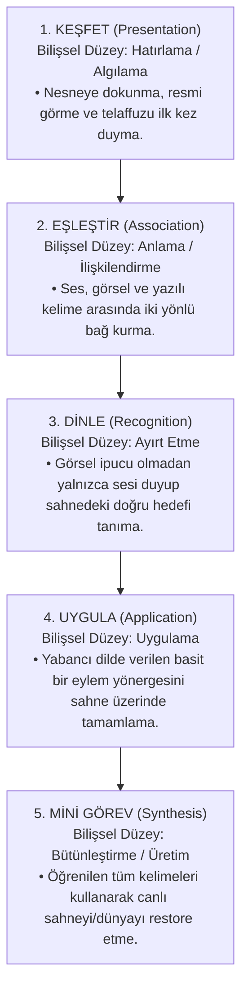

# VENTRA — DİL ÖĞRENME PLATFORMU V1
## 04: Pedagojik Dil Öğrenme Sistemi

---

## 1. Pedagojik Çerçeve ve CEFR Uyumu

Ventra'nın eğitim omurgası, uluslararası geçerliliğe sahip **Avrupa Dilleri Ortak Çerçeve Programı (CEFR)** ve modern **İletişimsel Dil Öğretimi (Communicative Language Teaching - CLT)** yaklaşımlarına dayanır.

### CEFR Seviye Dağılımı ve Yol Haritası:

| Seviye | Ventra Modülü | Hedef Kitle | Odak Alanı ve Kazanımlar |
| :---: | :---: | :---: | :--- |
| **Pre-A1 / A1.1** | **Kids World (V1 Kapsamı)** | 7–12 Yaş | Somut nesneler, hayvanlar, renkler, sayılar, basit selamlaşma ve tek eylemli yönergeleri anlama. |
| **A1.2 / A2** | **Kids World & Life World** | Tüm Yaşlar | Günlük rutinler, aile bireyleri, temel yiyecekler, duygu durumları ve 2-3 kelimelik kısa cümleler. |
| **B1 / B2** | **Life World (İleri Faz)** | 13+ Yaş | Seyahat, mesleki senaryolar, karmaşık diyaloglar, soyut fikirleri ifade etme ve akıcı diyalog. |

---

## 2. Dil Becerilerinin Öğretim Yöntemleri

Ventra dil edinimini 5 temel beceri sütununa ayırır:

1. **Kelime Dağarcığı (Vocabulary Acquisition):**
   * Kelimeler hiçbir zaman izole Türkçe-İngilizce kelime listeleri olarak verilmez.
   * Her kelime daima: **[Yüksek Kaliteli Görsel] + [Anadil Telaffuzu] + [Yazılı İsim] + [Bağlam İçi Kullanım]** dörtlüsüyle sunulur.
2. **Dinleme ve Fonetik Farkındalık (Listening & Phonemic Awareness):**
   * Çocukların doğru aksanı ve ses ayrımlarını yakalayabilmesi için farklı tonlama ve hızlarda temiz stüdyo kayıtları kullanılır.
   * "Minimal pairs" (örneğin *ship* vs. *sheep*) gibi benzer seslerin ayırt edilmesi interaktif oyunlarla pekiştirilir.
3. **Okuma ve Anlamlandırma (Reading & Context):**
   * Görsel kelime eşleştirmelerinden kısa hikaye kartlarına geçiş.
   * Harf ve ses ilişkisini doğal akışta kavratan görsel ipuçları.
4. **Yönerge Takibi ve Sözdizimi (Syntax & Directives):**
   * Gramer kurallarını teorik formüllerle anlatmak yerine eyleme dökme.
   * Örnek: *"Give the green apple to the rabbit"* eylemini yaparak özne-nesne-eylem ilişkisini içselleştirme.
5. **Konuşma ve Telaffuz (Speaking & Pronunciation):**
   * **V1 Kapsamında:** "Dinle ve Kendi Sesini Duy" (Listen & Echo) pratikleri.
   * **İleri Fazda:** Web Audio API ve makine öğrenimi tabanlı fonetik telaffuz analizi.

---

## 3. Beş Aşamalı Bilişsel Öğrenme Modeli

Her ders düğümü Bloom Taksonomisi'nin bilişsel hiyerarşisine paralel 5 adımdan oluşur:



---

## 4. Aralıklı Tekrar Sistemi (Spaced Repetition System - SRS)

Öğrenilen kelimelerin kalıcı hafızaya (long-term memory) aktarılması için Ebbinghaus Unutma Eğrisi'ne dayalı akıllı tekrar algoritması kurgulanmıştır.

### Tekrar Sandıkları (Leitner Kutusu Mantığı):
* **Sandık 1 (Yeni Öğrenilen):** 24 saat sonra tekrar edilir.
* **Sandık 2 (Pekiştirilen):** 3 gün sonra tekrar edilir.
* **Sandık 3 (Gelişen):** 7 gün sonra tekrar edilir.
* **Sandık 4 (Usta Olunan):** 21 gün sonra "Bölge Bakımı" görevlerinde hafifçe hatırlatılır.

### Oyunlaştırılmış Tekrar: "Bahçe Bakımı"
Kullanıcıya "eski kelimeleri tekrar et" demek yerine; haritadaki bitkilerin solmaması için **"Bahçeyi Sula"** veya **"Hayvanları Besle"** gibi 60 saniyelik neşeli mikro-görevler verilir.

---

## 5. Öğrenme Başarısının ve Beceri Ustalığının Ölçümü

Ventra, öğrenci başarısını tek bir puana değil, **somut kanıtlara (evidence count)** dayandırır.

### Ustalık Durumları (`MasteryStatus`):
* `insufficient_data`: Öğrenci henüz bu kelime/beceriyle ilgili yeterli alıştırma yapmadı (en az 2 geçerli deneme gerekir).
* `struggling`: Doğruluk oranı <%60 veya sürekli aynı ipucuna ihtiyaç duyuyor.
* `developing`: Doğruluk oranı %60–%84 arasında; pekiştirme aşamasında.
* `mastered`: Doğruluk oranı ≥%85 ve son iki oturumda bağımsız olarak doğru yanıtladı.

### Veri Sözleşmesi Örneği (`LanguageSkillMastery`):
```typescript
export interface LanguageSkillMastery {
  skillId: string;             // örn: 'en.a1.vocab.animals.farm'
  targetWord: string;          // 'rabbit'
  cefrLevel: 'Pre-A1' | 'A1' | 'A2' | 'B1' | 'B2';
  totalEncounters: number;     // Kaç kez karşılaşıldı
  correctCount: number;        // Kaç kez doğru yanıtlandı
  accuracyRate: number;        // 0.0 - 1.0
  lastPracticedAt: string;     // ISO 8601
  srsBox: number;              // 1 - 4
  nextReviewDate: string;      // Bir sonraki tekrar zamanı
  status: 'insufficient_data' | 'struggling' | 'developing' | 'mastered';
}
```

---

## 6. İçeriklerin İleri Seviyelere Genişletilmesi

Müfredat mimarisi, yeni dillerin (Almanca, İspanyolca, Fransızca) ve ileri seviyelerin kolayca eklenebilmesi için JSON/TypeScript tabanlı modüler bir yapıya sahiptir.

```text
packages/shared/src/curriculum/languages/
├── en/
│   ├── a1/
│   │   ├── animals.json       <-- V1 Vertical Slice
│   │   ├── colors.json
│   │   ├── numbers.json
│   │   └── family.json
│   ├── a2/
│   │   ├── daily_routines.json
│   │   └── places_in_town.json
│   └── b1/
│       └── travel_and_work.json
└── de/
    └── a1/
        └── tiere.json
```
Her JSON dosyası, kelime kimliklerini, ses yollarını, animasyon referanslarını ve yönerge metinlerini standart formatta sunar.

