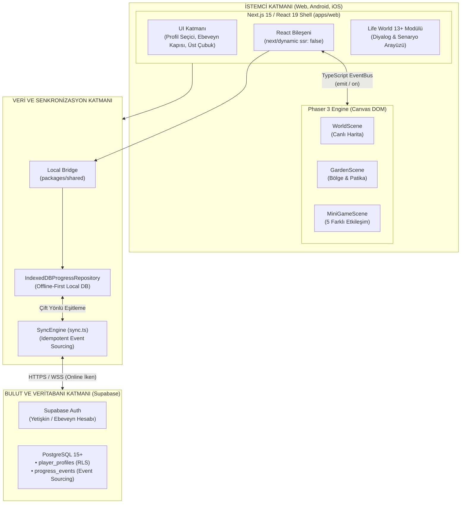

# VENTRA — DİL ÖĞRENME PLATFORMU V1
## 05: Teknik Mimari ve Sistem Tasarımı

---

## 1. Mimari Genel Bakış ve Teknoloji Yığını

Ventra V1, modern bir **Monorepo** mimarisi üzerinde; React'in zengin web arayüzü gücü ile Phaser'ın akıcı 2D oyun yeteneklerini tek bir çatı altında birleştirir.



---

## 2. Phaser 3 + React Entegrasyon Modeli

### Neden Godot ve Iframe Kaldırıldı?
Eski mimaride Godot Web, bir `<iframe>` içinde çalışıyor ve `window.postMessage` ile iletişim kuruyordu. Bu durum:
* **39.5 MB WASM + 6.3 MB PCK** yükü yaratarak Android APK'yı 55 MB'a şişiriyordu.
* Iframe arası veri serileştirme (serialization lag) ve dokunmatik odaklanma (touch focus) gecikmeleri yaratıyordu.
* iOS Safari WKWebView bellek sınırına (Jetsam RAM limit) takılma riski taşıyordu.

### Yeni Phaser Entegrasyonu (Doğrudan DOM İçi Canvas):
Phaser 3, React bileşeninin yaşam döngüsüne (lifecycle) doğrudan entegre edilir:

```typescript
// apps/web/src/components/game/PhaserGame.tsx
'use client';
import React, { useEffect, useRef } from 'react';
import Phaser from 'phaser';
import { EventBus } from '@/lib/game/EventBus';

export const PhaserGame: React.FC = () => {
  const gameContainerRef = useRef<HTMLDivElement>(null);
  const gameInstanceRef = useRef<Phaser.Game | null>(null);

  useEffect(() => {
    if (!gameContainerRef.current) return;

    const config: Phaser.Types.Core.GameConfig = {
      type: Phaser.AUTO,
      parent: gameContainerRef.current,
      backgroundColor: '#050914',
      scale: {
        mode: Phaser.Scale.RESIZE,
        autoCenter: Phaser.Scale.CENTER_BOTH,
        width: '100%',
        height: '100%'
      },
      physics: { default: 'arcade', arcade: { gravity: { x: 0, y: 0 } } },
      scene: [BootScene, WorldScene, GardenScene, MiniGameScene]
    };

    gameInstanceRef.current = new Phaser.Game(config);

    // React -> Phaser ve Phaser -> React Olay Dinleyicileri
    EventBus.on('PHASER_NODE_COMPLETED', handleNodeCompleted);

    return () => {
      EventBus.off('PHASER_NODE_COMPLETED', handleNodeCompleted);
      gameInstanceRef.current?.destroy(true);
    };
  }, []);

  return <div id="phaser-container" ref={gameContainerRef} className="w-full h-full relative" />;
};
```

### Next.js Static Export Uyumluluğu:
Next.js SSR aşamasında `window` nesnesi bulunmadığından, Phaser bileşeni Next.js'in dinamik import mekanizmasıyla yüklenir:
```typescript
import dynamic from 'next/dynamic';

const DynamicPhaserGame = dynamic(
  () => import('@/components/game/PhaserGame').then(mod => mod.PhaserGame),
  { ssr: false, loading: () => <LoadingSpinner /> }
);
```

---

## 3. Ortak Veri Sözleşmeleri (`packages/shared`)

Dil öğrenme modeline özel genişletilmiş sözleşmeler:

### `packages/shared/src/language.ts`
```typescript
export interface VocabularyItem {
  id: string;               // 'en_vocab_cat'
  word: string;             // 'cat'
  translationTr: string;    // 'kedi'
  audioUrl: string;         // '/audio/en/animals/cat.mp3'
  imageUrl: string;         // '/assets/animals/cat.png'
  category: 'animals' | 'colors' | 'numbers' | 'family';
  cefrLevel: 'A1.1' | 'A1.2' | 'A2';
}

export interface LearningStepPayload {
  stepIndex: number;        // 1 - 5
  stepType: 'explore' | 'match' | 'listen' | 'apply' | 'mini_task';
  targetItems: VocabularyItem[];
  promptTr: string;
  directiveEn?: string;
}

export interface GameCompletionEvent {
  profileId: string;
  regionId: string;         // 'word_garden'
  nodeId: number;           // 1 - 5
  skillId: string;          // 'en.a1.vocab.animals'
  score: number;            // 0 - 100
  starsEarned: number;      // 1 - 3
  accuracyRate: number;     // 0.0 - 1.0
  durationSeconds: number;
  completedAt: string;
}
```

---

## 4. Supabase ve IndexedDB Entegrasyonu (Offline-First)

Mevcut veritabanı şeması ve senkronizasyon motoru **hiçbir yıkıcı değişikliğe uğramadan korunur**:

1. **`player_profiles` Tablosu:**
   * Çocuk profilleri (takma ad, avatar) aynen kullanılır.
   * `user_id` ile ebeveyn hesabına bağlıdır; RLS ile tam kullanıcı izolasyonu sağlanır.
2. **`progress_events` Tablosu:**
   * `event_type IN ('learning_session', 'game_level')` kuralı mevcuttur.
   * `game_id` alanına `'phaser_word_garden'` gibi yeni oyun kimlikleri atanır.
   * `metrics JSONB` sütunu dil alıştırmalarının tüm detaylarını (yanlış kelimeler, deneme süreleri, ipuçları) esnek şekilde saklar.
   * **Veritabanı migration'ı GEREKTİRMEZ.**
3. **Çevrimdışı Çalışma Garantisi:**
   * Kullanıcı interneti kapalıyken bile tüm dersleri oynayabilir; ilerlemeler `IndexedDBProgressRepository` içine anında yazılır.
   * İnternet geri geldiğinde `SyncEngine` idempotent anahtarlarla (`event_id` UUID) olayları Supabase'e gönderir; çakışma ve veri kaybı önlenir.

---

## 5. Platformlar Arası Mimari ve Mobil Güvenceler

| Platform | Çalışma Modeli | Performans ve Bellek Güvencesi |
| :--- | :--- | :--- |
| **Web (Masaüstü & Mobil Tarayıcı)** | Standart modern tarayıcılar (Chrome, Safari, Firefox, Edge). | Canvas 2D / WebGL otomatik fallback. İlk yükleme boyutu < 3 MB. |
| **Android (Capacitor 6)** | Yerel Android WebView + Hardware Acceleration (`AndroidManifest.xml`). | APK boyutu 55 MB'tan **~12 MB'a** düşer. 60 FPS garantisi. |
| **iOS (Capacitor 6)** | WKWebView. | Godot WASM çekirdeği kalktığı için Jetsam bellek limiti (256MB) riski tamamen bertaraf edilir. |

### Mobil Ses ve Giriş Politikaları (Audio Autoplay & Touch):
* **Ses Kilidi:** Mobil tarayıcılar ve WebView'lar ilk kullanıcı dokunuşuna kadar sesi bloke eder. Ventra'nın karşılama ekranındaki "Dünyaya Gir" butonu bu dokunuşu yakalayarak `AudioContext` nesnesini kalıcı olarak uyandırır (resume).
* **Dokunmatik Gecikme:** Phaser'ın yerleşik pointer yöneticisi `300ms click delay` sorununu engeller.

