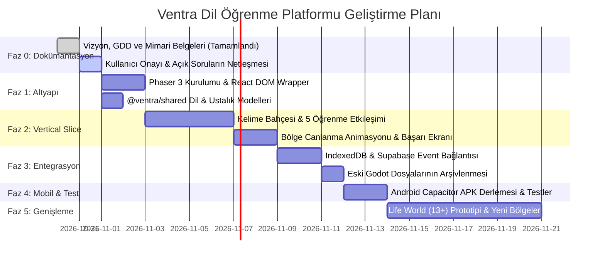

# VENTRA — DİL ÖĞRENME PLATFORMU V1
## 07: Karar Kayıtları (ADR) ve Geliştirme Yol Haritası

---

## 1. Karar Kayıtları (Architecture & Product Decision Register)

Tasarım ve mimari kararlar net bir statü ayrımıyla belgelenmiştir:

### A. APPROVED (Kesinleşen ve Onaylanan Kararlar)

* **ADR-01: Oyun Motoru Olarak Phaser 3 Seçimi**
  * *Karar:* Godot 4 Web motoru emekliye ayrıldı; çocuk dünyası için **Phaser 3 + TypeScript** benimsendi.
  * *Gerekçe:* 39.5 MB WASM ve iframe yükünü ortadan kaldırarak doğrudan React DOM içine entegre olabilme, mobil cihazlarda <15 MB APK boyutu ve iOS WKWebView bellek stabilitesi.
* **ADR-02: Dil Öğreniminin Birincil Amaç Olması**
  * *Karar:* Şehir kurma, kaynak toplama veya RPG mekanikleri ana oyun hedefi olmayacak; oyun dünyasının gelişimi dil öğrenmeyi motive eden bir ödül aracı olarak kalacak.
* **ADR-03: Yaşa Özel Çift Deneyim Modeli**
  * *Karar:* 7–12 yaş grubu için **Kids World** (Phaser 2D oyun dünyası), 13+ yaş grubu için **Life World** (modern React gerçek yaşam senaryoları) ayrımı yapıldı.
* **ADR-04: Mevcut Veri ve Altyapı Yatırımının Korunması**
  * *Karar:* Supabase Auth, çocuk profilleri (`player_profiles`), esnek olay günlüğü (`progress_events` JSONB), çevrimdışı `IndexedDBProgressRepository` ve Capacitor mobil yapılandırması sıfır veri kaybıyla korundu.
* **ADR-05: Güvenli Eski Sürüm Arşivlemesi**
  * *Karar:* Eski matematik ve Godot kod tabanı `C:\active_projects\Ventra_legacy_math_godot_backup_20261030` altında harici olarak arşivlendi ve doğrulandı.
* **ADR-06: Keşif Adası ve Görsel Yönelim (Visual Direction)**
  * *Karar:* **Alternatif B'nin kullanılabilir izometrik ada yerleşimi + Alternatif A'nın masalsı sıcak atmosferi + Alternatif C'nin ilerleme ve dönüşüm mekaniği** resmi görsel yön olarak onaylandı.
  * *Uygulama:* Ana harita üzerinde Merkez Üs, Kelime Bahçesi, Dinleme Ormanı, Konuşma Limanı ve Cümle Meydanı bağımsız hotspot'lar olarak kurgulandı.
* **ADR-07: İlk Dikey Dilim Kapsamı (Vertical Slice)**
  * *Karar:* A1 Başlangıç İngilizcesi — Hayvanlar (`cat`, `dog`, `bird`, `rabbit`) ve 5 adımlı öğrenme patikası (Keşfet -> Eşleştir -> Dinle -> Uygula -> Mini Macera) ile Kelime Bahçesi'nin canlanma (Durum A -> Durum B) döngüsü onaylandı ve geliştirildi.
* **ADR-08: Çevrimdışı Yerel Seslendirme Mimarisi**
  * *Karar:* İnternet bağımsız çalışması için `Microsoft Zira en-US` yerel ses sentezleyici ile 16-bit 44.1kHz PCM WAV dosyaları `public/audio/en/` dizinine paketlendi. Web Audio API uyandırma mekanizmasıyla mobil autoplay politikaları güvenceye alındı.

---

### B. OPEN / TODO (Cevaplanacak Sorular ve Gelecek Aşamalar)

* **OPEN-01: iOS Fiziksel Cihaz Doğrulaması**
  * *Durum:* Geliştirme ortamı Windows olduğundan iOS çıktısı **NOT TESTED** statüsündedir; macOS/Xcode ortamında fiziksel cihazda doğrulanmalıdır.
* **OPEN-02: Gelecek Bölgelerin Açılış Sırası**
  * *Konu:* 2. Bölge olarak Dinleme Ormanı (Listening Forest) mı, yoksa Konuşma Limanı mı açılacak?
* **OPEN-03: Stüdyo Kaydı Seslendirme Geçişi**
  * *Konu:* Mevcut yerel Zira WAV paketinin sonraki sürümlerde profesyonel çocuk tiyatro oyuncusu/seslendirmeni kayıtlarıyla zenginleştirilmesi.

---

## 2. Geliştirme Yol Haritası (Roadmap)

### Aşama Detayları:
1. **Faz 0 — Dokümantasyon ve Tasarım Onayı (ŞU ANKİ AŞAMA):**
   * Tüm vizyon, wireframe, GDD, pedagoji ve teknik mimari belgeleri hazırlandı. Kullanıcı onayı beklenmektedir.
2. **Faz 1 — Altyapı ve Veri Sözleşmesi:**
   * `apps/web` projesine `phaser` eklenmesi; `packages/shared/src/language.ts` oluşturulması.
3. **Faz 2 — Kids World Vertical Slice (Phaser):**
   * `WorldScene`, `GardenScene` ve 5 etkileşimli öğrenme adımının kodlanması.
4. **Faz 3 — İlerleme ve Senkronizasyon Entegrasyonu:**
   * Phaser'da kazanılan yıldızların `IndexedDBProgressRepository` üzerinden Supabase'e akması; eski Godot çıktılarının temizlenmesi.
5. **Faz 4 — Mobil Derleme ve Kalite Güvencesi:**
   * Android APK derlemesi, WebGL/Canvas performans testleri, çevrimdışı mod testi.
6. **Faz 5 — Gelecek Vizyon (Life World 13+ & İleri Seviyeler):**
   * Genç/yetişkin React senaryoları ve yeni coğrafi bölgelerin eklenmesi.

