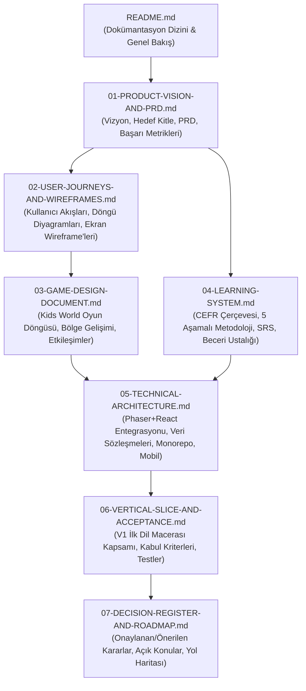

# VENTRA — DİL ÖĞRENME PLATFORMU V1
## Dokümantasyon Dizini ve Proje Kılavuzu

**Ürün:** Ventra Language Learning Platform  
**Sürüm:** V1.0 (Dokümantasyon & Tasarım Aşaması)  
**Tarih:** 30 Ekim 2026  
**Durum:** Tasarım ve Mimari Onay Aşaması (Kod geliştirme öncesi)  
**Önceki Matematik/Godot Yedeği:** `C:\active_projects\Ventra_legacy_math_godot_backup_20261030`

---

## 1. Ürün Özeti

Ventra; kullanıcıların dil öğrenirken etkileşimli görevler tamamladığı, ilerledikçe gelişen canlı dünyalar keşfettiği, oyunlaştırılmış yeni nesil bir dil öğrenme platformudur.

Eski 4. sınıf matematik odaklı deneysel yapıdan tamamen farklı olarak Ventra V1; **dil edinimini birincil amaç** haline getiren, oyun mekaniklerini ise kullanıcıyı motive eden bir **ödül ve görsel tatmin aracı** olarak konumlandıran hibrit bir mimariye sahiptir.

Ürün iki temel yaş deneyimine hitap eder:
1. **Kids World (7–12 Yaş):** Phaser + TypeScript ile inşa edilen, renkli, dokunmatik, bölge geliştirme ve adım adım baloncuklu öğrenme yolu sunan oyunlaştırılmış macera dünyası.
2. **Life World (13+ Yaş):** React + Next.js + TypeScript ile inşa edilen, gerçek yaşam senaryolarına, diyaloglara ve modern öğrenme araçlarına odaklanan olgun deneyim.

---

## 2. Onaylı Temel Prensipler

- **Dil Öğrenmek Birincil Amaçtır:** Oyun mekanikleri dil öğrenmenin önüne geçemez, öğrenmeyi sulandıramaz veya dikkat dağıtamaz.
- **Oyun Gelişimi = Pedagojik Ödül:** Kullanıcı şehir simülasyonu oynamaz, kaynak yönetimiyle boğuşmaz; dersleri tamamladıkça keşfettiği dünya canlanır, renklenir ve yeni bölgeler açılır.
- **Çoktan Seçmeli Test Kısırlığına Son:** Kullanıcıyı sürekli A/B/C/D şıklarına boğan sıkıcı testler yerine; keşfetme, dinleme, nesneyle etkileşime girme ve bağlamsal yönergeleri uygulama gibi zengin etkileşimler sunulur.
- **Teknoloji Yığını (Kesinleşen):**
  - **Phaser 3 + TypeScript:** Çocuk dünyası 2D etkileşimli canvas motoru (Iframe olmadan doğrudan React içine gömülü).
  - **Next.js 15 + React 19 + TypeScript:** Uygulama kabuğu, öğrenme merkezleri ve 13+ deneyimi.
  - **Supabase Auth + PostgreSQL:** Kimlik doğrulama, ebeveyn hesabı, güvenli RLS ve bulut ilerleme eşitlemesi.
  - **IndexedDB:** Çevrimdışı öncelikli (offline-first) yerel cihaz ilerleme deposu.
  - **Capacitor 6:** Android ve iOS mobil uygulama kabuğu.

---

## 3. Doküman Haritası ve Okuma Sırası

Dokümantasyon paketi birbirini tamamlayan 7 ana modülden oluşmaktadır:

| Dosya Adı | Kapsamı ve Amacı |
| :--- | :--- |
| [**01-PRODUCT-VISION-AND-PRD.md**](./01-PRODUCT-VISION-AND-PRD.md) | Ürün vizyonu, hedef kullanıcı segmentleri, pedagojik kimlik, MVP ve uzun vadeli kapsam, başarı ölçütleri (retention, tamamlama oranları). |
| [**02-USER-JOURNEYS-AND-WIREFRAMES.md**](./02-USER-JOURNEYS-AND-WIREFRAMES.md) | Uçtan uca kullanıcı yolculukları, "Dünya → Bölge → Yol → Dil Becerisi → Görev → Ödül → Gelişim" temel döngüsü, mobil/masaüstü metinsel wireframe'leri. |
| [**03-GAME-DESIGN-DOCUMENT.md**](./03-GAME-DESIGN-DOCUMENT.md) | Kids World (7–12) oyun tasarım detayları, bölge canlanma mekaniği, 5 farklı etkileşim türü, geri bildirim ve görsel-işitsel UX ilkeleri. |
| [**04-LEARNING-SYSTEM.md**](./04-LEARNING-SYSTEM.md) | CEFR A1 başlangıç müfredatı, 5 aşamalı bilişsel öğrenme modeli (Keşfet, Eşleştir, Dinle, Uygula, Mini Görev), aralıklı tekrar (SRS) ve ustalık formülasyonu. |
| [**05-TECHNICAL-ARCHITECTURE.md**](./05-TECHNICAL-ARCHITECTURE.md) | Phaser 3'ün React içine entegrasyonu, TypeScript EventBus, Supabase ve IndexedDB entegrasyonu, Capacitor mobil bellek ve performans güvenceleri. |
| [**06-VERTICAL-SLICE-AND-ACCEPTANCE.md**](./06-VERTICAL-SLICE-AND-ACCEPTANCE.md) | İlk çalışır dil macerasının (Kelime Bahçesi örneği) ekran ekran kabul kriterleri, test senaryoları, performans sınırları ve kapsam dışı bırakılanlar. |
| [**07-DECISION-REGISTER-AND-ROADMAP.md**](./07-DECISION-REGISTER-AND-ROADMAP.md) | Onaylanan (APPROVED), önerilen (PROPOSED) ve kullanıcı kararı bekleyen (OPEN) konular, aşamalı geliştirme yol haritası. |

---

## 4. Karar Özeti ve Statü Dağılımı

* **APPROVED (Kesinleşenler):**
  * Godot motorunun emekliye ayrılması; yerine **Phaser + React** kullanılması.
  * Dil öğrenmenin birincil amaç olması; şehir kurma gibi karmaşık mekaniklerin dışlanması.
  * Mevcut Supabase Auth, çocuk profilleri ve çevrimdışı IndexedDB mimarisinin sıfır veri kaybıyla korunması.
  * 7–12 yaş (Kids World) ve 13+ yaş (Life World) deneyim ayrımı.
* **PROPOSED (Örnek Tasarım Olarak Sunulanlar):**
  * İlk vertical slice için örnek tema: **Kelime Bahçesi (Word Garden)**.
  * İlk vertical slice için örnek pedagojik içerik: **A1 Başlangıç İngilizcesi — Hayvanlar**.
  * 5 Aşamalı Öğrenme Yolu Düğüm Yapısı (Keşfet, Eşleştir, Dinle, Uygula, Mini Görev).
* **OPEN (Kullanıcı İncelemesine Sunulan Açık Sorular):**
  * İngilizce seslendirme kaynağı (stüdyo kaydı vs. sentetik Web Speech API).
  * Görsel sanat tarzı (2D Vektörel/İllüstrasyon vs. Pixel Art vs. İzometrik).
  * Dil müfredatı standardı (Genel CEFR A1 vs. Cambridge Young Learners Starters).

---

> [!IMPORTANT]
> Bu dokümantasyon onaylanmadan **hiçbir kod yazılmayacak, dosya silinmeyecek veya bağımlılık kurulmayacaktır**.  
> Projenin önceki matematik sürümü `C:\active_projects\Ventra_legacy_math_godot_backup_20261030` altında güvenle saklanmaktadır.

